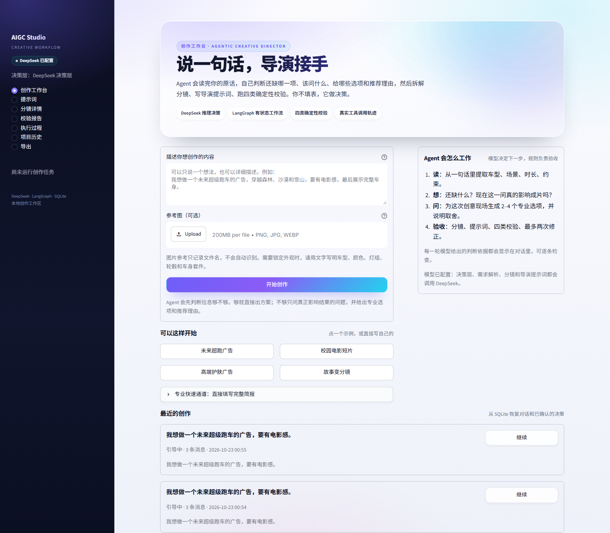
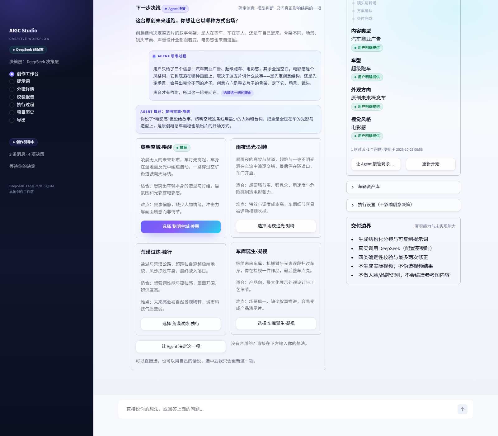
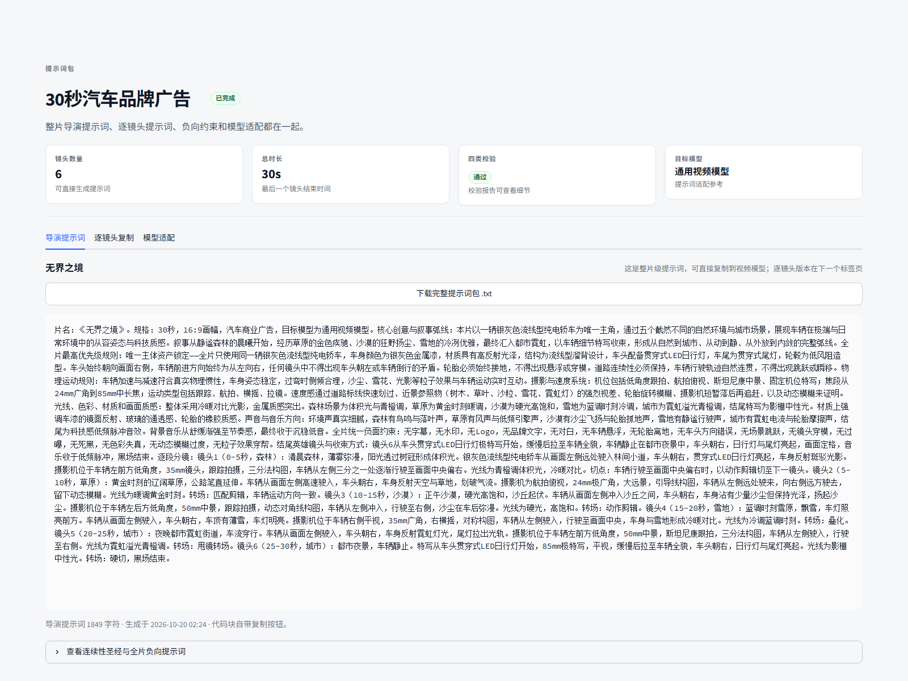

# AIGC 智能创作工作流 Agent

面向 AI 图片、AI 视频和商业广告创作的有状态 Agent 工作流。项目目标是让系统能够解析需求、制定任务计划、调用真实 Python 工具、检查结果、记录执行轨迹并持久化项目，而不是简单包装一个聊天界面。

> **仓库里现在有两个应用，别把它们搞混。**
>
> | 应用 | 入口 | 说明 |
> | --- | --- | --- |
> | Lunar Studio（新） | `studio/`，FastAPI + React，<http://127.0.0.1:8600> | 图像优先的本地创作台：影视图 / 电商图，技能驱动规划，本机 ComfyUI 真出图。有自己的数据库 `studio/data/lumen.sqlite3`。详见 [studio/README.md](studio/README.md)。 |
> | Streamlit 工作台（旧） | 根目录 `app.py`，<http://localhost:8501> | 本文件下面描述的就是它：分镜 / 提示词 / 校验 / 视频生成。数据在 `data/` 与 `output/`。 |
>
> 两者共用仓库根 `.env` 和本机 ComfyUI，其余互不读写。

当前仓库已完成**第一阶段 MVP**、**阶段 2A-1：专业词表与分镜字段**、**阶段 2A-2：DeepSeek 需求解析**、**阶段 2B-1：DeepSeek 分镜生成与确定性提示词生成**、**阶段 2B-2：综合校验与自动修正循环**、**阶段 2C：Streamlit 创作工作台、项目历史与导出**、**阶段 2D：20 条评测、项目报告与答辩材料**，并进入**阶段 3：主动引导式创作 Agent**。阶段 3 的核心不是把表单换成聊天框，而是新增可持久化的创作决策状态：Agent 从一句话中提取信息，根据缺失项和重要性决定下一问，给出专业选项与推荐理由，允许用户逐项修改或授权 Agent 自主决定，再把确认后的方案交给原有 LangGraph 工作流执行。**阶段 3 已重构为模型驱动**：每一轮的下一步动作、提问内容、候选选项和推荐理由由 DeepSeek 判断，模型自己的推理依据会原样展示在界面上；模型不可用时不退回写死的选项表，而是明确报「决策层不可用」。真实 API 已验证需求解析、分镜生成、校验失败、修正和导演提示词生成；修正最多 2 次。英文偏好模型的提示词方言转换、图片内容识别和已有完整分镜的自动解析尚未实现。已实现与未实现内容在本文末尾明确区分。

## 当前已实现

- 结构化创作需求输入（Pydantic 校验）。
- DeepSeek 需求解析：
  - 使用 OpenAI 兼容 SDK 调用 `deepseek-chat`；
  - 模型输出经过 Pydantic 校验；
  - 超时、429、5xx 有限重试；
  - 记录调用次数、重试次数、错误次数和 token 用量；
  - 错误信息脱敏，不记录 API 密钥；
  - `--use-llm` 显式开启，未开启时保持确定性模式。
- DeepSeek 结构化分镜生成：
  - 按专业枚举输出景别、机位、运镜、灯光、色彩、转场、屏幕方向；
  - 枚举接受模型常见的同义写法并归一化：`medium_wide_shot` / `Medium Wide Shot` / `中远景` 都能落到 `medium_wide_shot`，`全景`、`特写`、`MCU`、`close-up`、`dolly in`、`低调`、`慢动作` 等同理；
  - 词表补全：景别新增 `full_shot`（全景）、`medium_wide_shot`（中远景）、`cowboy_shot`（牛仔镜头）；机位新增 `ground_level`；运镜新增 `crane_orbit`、`dolly_zoom`、`pedestal_up/down`、`whip_tilt`；灯光新增 `high_key` / `low_key`；转场新增 `fade_to_black`；
  - 归一化不了的取值仍然明确失败，不猜、不改成最近的合法值；
  - 结构非法的响应会带上校验错误**重试一次**，仍失败才判定失败（只重试一次，且只针对结构错误，不对网络错误或额度错误重试）；
  - 每次生成都会把「模型原样写了什么 → 归一化成什么」记进执行轨迹（`vocabulary_normalised` / `vocabulary_unknown`），用真实用量补词表，而不是靠猜；
  - 记录模型调用与 token 用量。
- 提示词体裁层（`config/prompt_dialects.py`，阶段 3 追加）：
  - 八个体裁，各有独立的写作标准：电商视觉 / 品牌广告 / 科幻影视 / 人文剧情 / 动作追逐 / 动画动漫 / 创意实验 / 纪实；
  - 每个体裁定义：写作者身份、整片必须按顺序写出的章节、每个逐镜头提示词必须交代的信息、这个体裁禁止的写法、默认负面词、合理篇幅；
  - 体裁由需求解析模型选择（`CreativeRequirement.prompt_dialect`），缺失时按内容类型推断；
  - 生成后自动做体裁审计，把「这个体裁必须出现、但文本里没找到」的项列出来，显示在提示词页；
  - 效果差异是结构性的：电商片 551 字、写清 60% 占画比与文字安全区；科幻片 2115 字、写清尺度参照与光源物理来源；动漫片 711 字、写清线条与作画重心，负面词各自覆盖本体裁的典型失败模式。
- 图片与视频分开写（`image_prompt` / `video_prompt`）：
  - 两种提示词是不同任务：图片提示词冻结一帧（景别、焦段、构图、光位、材质、画幅），禁止写时间推进与镜头运动；视频提示词描述画面怎么变（时长、起止状态、摄影机运动、主体运动、切点），禁止只写一帧的静态描述；
  - 通用的格式规则写在 `IMAGE_RULES` / `VIDEO_RULES`，体裁再追加自己的侧重（电商的图片侧重商品占比与文字位，视频侧重展示动作；动作片的图片侧重方向与参照物在同一帧内可读）；
  - 提示词页拆成「图片生成」「视频生成」两个板块，各自整包复制/下载、各自逐条查看；
  - 两级审计分开：体裁审计看内容，`image_audit` / `video_audit` 看格式，缺失项分别显示在对应板块。
- 导演级提示词生成（真实模式）：
  - 基于已通过校验的分镜，调用 DeepSeek 写整片导演提示词、连续性圣经和逐镜头提示词；
  - 写作指令由体裁标准生成，再叠加汽车/非汽车的主体资产规则：汽车项目写车辆资产、车头方向、轮胎接地和道路连续性；其他项目写主体资产、走位、视线、空间连续性和节奏，不输出车辆专属章节或“不适用”占位；
  - 逐镜头提示词由模型重写，不再只是字段标签拼接；
  - 模型失败时明确标记失败，不用兜底结果伪装成导演提示词。
- 确定性图片/视频提示词生成（兜底）：
  - 演示模式或导演提示词不可用时，从结构化分镜字段拼装提示词；
  - 根据目标模型档案处理负向提示词支持差异；
  - 同一输入得到相同提示词，便于测试和复盘。
- 由 LangGraph 执行的状态工作流：
  `analyze_requirements → plan_workflow → generate_storyboard → generate_prompts → validate_output → write_director_prompt`
  - 校验通过 → `write_director_prompt → finalize_result`
  - 演示模式 → 导演提示词节点标记跳过 → `finalize_result`
  - 校验失败且修正次数 < 2 → `revise_output → generate_prompts → validate_output`
  - 达到上限或修正失败 → `finalize_result`（明确失败）
- 模型驱动的决策层（`services/agent_director.py`）：
  - 每一轮由 DeepSeek 决定「下一步做什么」：继续追问、给出方案、修改方案还是开始生成；
  - 问哪一项、为什么现在问、给哪些选项、推荐哪一个，全部由模型现场判断，不再查写死的选项表；
  - 选项按当前创意生成，不是通用模板；每个选项必须给到可执行的制作参数：
    - `label`：「技术 + 画面」，例如「单灯硬光·静止雕塑」；
    - `technique`：焦段 / 光位与光质 / 摄影机运动 / 画质参数，用「·」连接，至少两项；
    - `description`：这套参数拍出来观众看到什么；
    - `best_for`：什么品类与传播目标下选它；
    - `tradeoff`：制作代价（置景、周期、后期量、预算），不能只写审美取舍；
    - `reference`：可对照的广告 / 电影 / 摄影师 / 品牌，没有就写「无」；
  - 提示词里带「不合格 vs 合格」的对照样例，避免模型输出「高级质感」这类没有参数的形容词；
  - 模型返回自己的 `reasoning`，界面以「Agent 思考过程」原样展示，可逐条核对，不伪造思考动画；
  - 契约容错：接受 `text`/`prompt` 等同义键，`understood` 按字段别名归位，无法归属的字段直接丢弃；
  - **字段随品类变化**：只有汽车项目才存在 `vehicle_*` 字段。非汽车项目的系统提示、用户提示和决策面板里都不会出现车型、外观方向、车头、车灯、轮胎、道路，模型写回这些字段也会被引擎丢弃——校园短片不会被问「车在不在场」；
  - **没有规则兜底**：模型不可用、超时、返回非法结构或问句无法归位时，对话直接报「决策层不可用」，不会退回到写死的选项表假装在工作；
  - `AIGC_GUIDE_MODE=auto|llm|rules` 控制是否启用对话层；`rules` 等于关闭对话层，只保留工作流与历史浏览。
- 主动引导式创作对话（阶段 3）：
  - 用户只输入一句自然语言即可开始，不需要先填写项目名称、主体、动作、场景等内部字段；
  - Agent 从输入中提取已知信息，按“是否影响最终结果”决定下一问，已明确的信息不会重复询问；
  - 每个关键问题提供专业选项、通俗解释、适合类型和推荐理由；推荐会随车型、创意、场景和时长变化；
  - 三种推进方式：主动引导、用户授权 Agent 自主决定、详细需求快速通道；
  - 用户可逐项修改，也可以直接说“把沙漠改成海岸公路”“缩短到 15 秒”；修改只更新受影响决策，保留其他已确认内容；
  - 对话、消息、字段来源（用户明确/用户选择/Agent 推断/系统默认/资产）和确认状态写入 SQLite；
  - 支持最近对话恢复、项目历史恢复、车辆资产保存与复用；
  - 参考图上传只记录文件名，不冒充视觉识别；当前 DeepSeek 文本模型不做图片理解。
- 四类确定性校验：
  - 时长：非数字、负时长、重叠、空档、总时长与容差；
  - 场景覆盖：必需场景缺失、重复场景警告、覆盖率；
  - 主体一致性：连续性锁、原样主体描述、车辆方向、屏幕方向、文本方向矛盾；
  - 提示词质量：必要字段、矛盾约束、单镜头多运镜、模型负向提示词差异。
- 自动修正循环：
  - 使用 DeepSeek 按具体校验错误修正分镜；
  - 无模型时可确定性修复时长问题；
  - 最多 2 次，达到上限后输出失败报告；
  - 修正历史写入 SQLite，包括原因、前后摘要、工具和 token 用量。
- Streamlit 提示词优先工作台：
  - 创作工作台：一句话输入、主动追问、动态选项卡、专业推荐、方案确认、增量修改、最近对话恢复；专业快速通道折叠保留；
  - 模型自动选择：配置密钥时自动使用 DeepSeek，未配置时明确显示演示模式；
  - 提示词包：整片可复制包、逐镜头图片/视频/负向提示词、TXT 下载、模型适配；
  - 分镜详情：分镜表、镜头详情、摄影参数、连续性约束；
  - 校验报告：时长、场景、一致性、提示词四类状态与未执行标记；
  - 执行过程：真实流式事件、任务计划、工具轨迹、修正记录；
  - 项目历史：SQLite 读取、搜索、状态筛选、排序、历史项目载入；
  - 导出：Markdown / JSON 写入 `output/`，唯一文件名，页面下载。
- 模型自动选择：
  - 配置 `DEEPSEEK_API_KEY` 时自动使用真实模型；
  - 未配置时进入明确标注的演示模式，不再让用户手动开关模型。
- 统一视觉系统：
  - `.streamlit/config.toml` 主题 + 自有 HTML/CSS 组件类；
  - 中性灰背景、白色内容面、深色文字、克制蓝色强调；
  - 统一状态徽章、统计卡、空状态、分隔线和字体层级。
- 工程分层：
  - `ui/theme.py` 设计规范；
  - `ui/state.py` 会话状态、创作对话、后台执行、数据读取；
  - `ui/components.py` 可复用组件；
  - `ui/pages/` 八个页面（新增 `本地生成`）；
  - `schemas/conversation.py` 创作决策、问题、方案和消息契约；
  - `services/conversation_service.py` 主动引导、专业推荐、增量修改和需求构建；
  - `tools/export_tool.py` 导出；
  - `services/project_service.py` 流式执行、同项目新版本执行与持久化。
- 20 条可复现评测：
  - 8 条确定性工作流、9 条脚本化 LLM 工作流、3 条工具级用例；
  - 自动生成 Markdown/JSON 报告；已提交版本在 `docs/evaluation_report.md` 和 `.json`；
  - 默认使用 FakeLLM，不调用真实 API，不消耗额度；
  - 当前结果：20/20 行为符合预期，17/17 工作流状态与 SQLite 一致。
- 项目文档与答辩材料：
  - `docs/report.md`：项目报告；
  - `docs/evaluation_report.md`：自动生成的评测报告；
  - `docs/defense.md`：答辩提纲、讲稿和问答；
  - `docs/defense_slides.html`：可浏览器播放、可打印为 PDF 的幻灯片；
  - `docs/defense_slides.pdf`：已生成的 12 页 PDF。
- 真实的工具调用轨迹：
  - 记录节点名、工具名、工具参数、输入摘要、输出摘要、状态、错误和时间；
  - 轨迹中的工具参数和输出来自实际函数调用。
- SQLite 持久化：
  - 项目与结构化需求；
  - 任务计划；
  - 分镜时间数据；
  - 综合校验报告；
  - 修正历史；
  - 执行记录与工具轨迹；
  - 创作对话、消息、字段来源与方案状态（`creative_sessions`）；
  - 可复用车辆资产（`creative_assets`）。
- 专业摄影词表与分镜字段扩展：
  - 景别、机位角度、运镜、灯光、色彩分级、转场、特效、屏幕方向；
  - 镜头叙事职责、起止状态、声音、负向提示词、连续性锁、参考图用途。
- 确定性提示词检查工具：
  - 检测胶片颗粒与 4K 超清、慢动作与高速动作等矛盾；
  - 检测单个镜头中同时出现多种运镜；
  - 检查专业镜头必填字段是否完整。
- 外部资料调研记录：
  - `docs/references.md` 记录来源、star、许可证和借鉴边界；
  - 不复制外部仓库代码或大段文字。
- 命令行入口与项目重新读取命令。
- 时长按「生成条数 × 单条秒数」规划，超出本机模型能力的时长会被拒绝并给出拆分建议。
- 本地 ComfyUI 接入：读取 API 工作流、填入提示词、逐镜出片并落库（`本地生成` 页面）。
- 213 条默认自动化测试，以及 1 条需要真实 API 的可选测试。

## 尚未实现

以下内容没有在当前 MVP 中实现，不能视为已完成：

- Veo、Runway 等英文偏好模型的提示词方言转换。
- 云端图片/视频生成 API（Veo、Runway、可灵等）的直连；本地 ComfyUI 已接通。
- 图片/参考图的视觉理解；当前只记录文件名，不识别图中车型、颜色或品牌。
- 用户粘贴完整分镜后的自动结构化和逐镜头热修改；当前修改会复用同一项目重新生成新版本。
- 多 Agent 协作、Docker、Redis、向量数据库。
- 用户登录、多租户和远程部署。

未配置模型或命令行未开启 `--use-llm` 时，分镜是 Python 按场景数量等分时长生成的**确定性占位分镜**；Streamlit 配置密钥后自动使用 DeepSeek，命令行使用 `--use-llm` 显式开启。两种模式下都会执行确定性提示词拼装、四类校验和有限修正。

## 时长就是生成条数

**一条视频 = 一次生成调用。** 没有哪个模型能一次性吐出一条 90 秒的片子，
本地模型更不可能。所以这里的时长不是自由数字，而是「条数 × 单条秒数」：

| 本机模型 | 单条能力 | 30 秒成片 | 90 秒 |
|---|---|---|---|
| MiniMax H3（`EmptyMiniMaxH3LatentAV`） | 24 fps，`length` 按 17k+5 网格：5 秒→124 帧，10 秒→243 帧；训练区间 124–362 帧 | 6 条 × 5 秒 ≈ 23 分钟 | **做不到**：18 条，超过 12 条上限；turbo 也要 1.5 小时以上 |

- 单条秒数来自**工作流自己的声明**（`_meta.studio_clips`，没有就取默认值），
  其次是 `config/cinematography.py` 里该模型的可选值；都没有时按 5/10 秒。
- 成片时长只能是可拼出来的值：`services/clip_plan.py` 负责算，
  算不出来就直说「15 秒不能用 4/6/8 秒的片段拼出来，最近的是 16 / 12 / 18 秒」。
- 导演层拿到的提示词里带一段【生成能力约束】，所以它不会再给你 90 秒这种选项；
  真给了，引擎会在选项层面过滤掉，并在 brief 里留下拒绝说明。
- 需求里会写入 `clip_seconds` / `clip_count`，分镜的提示词明确要求
  「N 个镜头，每个 X 秒」，生成页按这个清单逐条提交。
- 成本是可算的：本机 H3 Turbo 5 秒一条 235 秒、10 秒一条 582 秒（**2.48 倍**，不是 2 倍）。
  所以 30 秒用 6 条 5 秒 ≈ 23 分钟，比 3 条 10 秒（29 分钟）更便宜，镜头也更细。
  规划器因此优先「更多、更短的片段」，10 秒仍然可以在页面上手动指定。关闭 Turbo 就乘 6。

## 本地生成：把提示词直接喂给本机模型

`本地生成` 页面是提示词之后的最后一步：把每一镜的 prompt 填进 ComfyUI 的
API 工作流，提交、轮询、下载、落库，一条不多一条不少。

- 后端探测：`/system_stats` 拿到版本、设备和显存；连不上就直说，不排队不假装。
- 没开也能用：页面上的「启动 ComfyUI」按 `.env` 里配好的 Python 和安装目录
  把服务拉起来（模型目录配置按实际子目录自动生成），起来后自动重连。
  没配置就明确告诉你缺哪几个环境变量，不会假装在重试。
- 工作流：放 `workflows/*.json`，ComfyUI 里 **Workflow → Export (API)** 导出。
  UI 格式（带 `nodes`/`links`）会被明确拒绝，因为提交不了。
- 占位符：`{{prompt}}` `{{negative}}` `{{seconds}}` `{{width}}` `{{height}}`
  `{{seed}}` `{{project}}` `{{shot}}`；没有占位符时按图结构找文本节点。
- 一镜一次调用：`POST /prompt` → `GET /history` → `GET /view`，
  文件写进 `output/media/<project>/`，同时写入 `generated_media` 表。
- **「是否实现？」**：提示词写完、任务跑完之后，工作台和提示词页都会问这一句，
  两个按钮分别是「生成图片（N 张）」「生成视频（N 条）」。图片提示词走图片模型，
  视频提示词走视频模型，进去会自动选好对应的那一类，不用手动挑。
- 分辨率可选：8 GB 显卡默认 768×432（H3 在 1344×768 上实测 OOM），
  显存更大时默认档位自动上移；OOM 的报错会附带「调小分辨率或开 Turbo」的提示。
- 进度：提交后每秒刷新一次，显示「第 2 / 6 条 生成中 · 已用 1:43 · 预计还需 2:10」。
  ComfyUI 的 HTTP 接口没有步数（步级进度只在 websocket 里），所以用 `/queue` 区分
  排队还是生成中，用已完成条目的平均耗时估剩余；第一条没有参考时只报已用时间。
- 失败就是失败：服务端没输出文件时该镜标记 failed 并保留原始报错，
  不会生成占位视频；失败记录没有文件路径，列表里也不会去读空路径。

实测（本机 ComfyUI 0.42.3 / RTX 4060 8 GB / Z-Image Turbo 8 步 / 1024×576）：

```text
status done
['output\\media\\demo\\shot_01.png']
```

提示词是「夜晚教学楼天台，一个人背对镜头看向远处城市灯光，35mm，冷蓝夜色与暖色窗光对比」，
出图见 `docs/screenshots/local_generation.png`。
`workflows/zimage_turbo.json` 就是这次跑通的那张图，改模型名即可复用。

### 视频实测（MiniMax H3，本机）

你保存的 H3 工作流是 UI 格式且带 subgraph，我按它展开成了
`workflows/minimax_h3_t2v.json`（节点和连线与原图一致）。
然后用同一套代码提交、轮询、取片：

```text
queued 7ac22dd5-...
done in 233.6 s [{'filename': 'h3_00003_.mp4', 'subfolder': 'aigc', 'type': 'output'}]
```

- 输出：124 帧 / 24 fps / 5.17 秒 / 768×432，带 AAC 音轨；
- 本机耗时：**Turbo 8 步 4 分钟**，全量 20 步 25 分钟（你上次那次，日志原文
  `Prompt executed in 00:25:19`）；
- 画面见 `docs/screenshots/h3_first_frame.png` 与 `h3_mid_frame.png`，
  整段视频在 `docs/screenshots/h3_demo.mp4`。

注意：H3 的 `length` 是 17k+5 网格，5 秒落到 124 帧、10 秒落到 243 帧（训练区间上限附近）。
换算留在工作流里（`ComfyMathExpression`），工作室只改那个标了
`Studio Duration` 的浮点数。Turbo 开关在页面上是一个复选框。

### 5 秒 vs 10 秒：同一条提示词、同一个种子、同一分辨率

| | 5 秒 | 10 秒 |
|---|---|---|
| 帧数 | 124 | 243 |
| 耗时（Turbo 8 步 / 768×432） | **235.1 s** | **581.9 s**（2.48×） |
| 首帧→末帧画面变化 | 24.71 | 30.87（只多 25%） |
| 每帧运动量 | 1.559 | 0.696（降 55%） |
| 帧间稳定性（标准差） | 0.460 | 0.177 |

结论：**10 秒不是多演一段，而是把同一段放慢。** 总变化只多 25%，运动被摊薄，
画面确实更稳，但一个 10 秒片段里仍然只有一个节拍。配合超线性的耗时，
规划器默认按 5 秒切，10 秒留给确实需要一镜到底的慢镜头。
对比图：`docs/screenshots/h3_5s_vs_10s.png`。

## 技术栈

| 组件 | 当前版本 | 状态 |
|---|---:|---|
| Python | 3.13.3 | 已验证 |
| LangGraph | 1.2.16 | 已安装并运行 |
| langchain-core | 1.6.12 | 由 LangGraph 依赖安装 |
| Pydantic | 2.14.1 | 已安装并运行 |
| python-dotenv | 1.2.4 | 已安装 |
| pytest | 9.1.1 | 已安装，213 项通过 |
| OpenAI SDK | 3.35.1 | 已安装并完成真实 DeepSeek 调用 |
| Streamlit | 1.66.0 | 已安装并通过 AppTest |
| SQLite | Python 标准库 sqlite3 | 已使用 |
| 摄影/分镜词表 | 项目自建，参考公开资料 | 已实现 |
| DeepSeek API | `deepseek-chat` | 已接入需求解析、分镜生成和修正并验证 |
| 综合校验/修正 | 项目自建 | 已实现 |
| 导出 | Markdown / JSON | 已实现 |

## 目录结构

```text
aigc_creative_agent/
    app.py             # Streamlit 入口
    main.py            # 命令行入口
    requirements.txt
    pytest.ini
    .env.example
    .gitignore
    README.md

    .streamlit/
        config.toml    # 主题与浏览器配置

    config/
        cinematography.py
        prompt_dialects.py   # 八个体裁的提示词写作标准与体裁审计
        settings.py

    agent/
        graph.py
        state.py
        nodes.py
        routing.py

    schemas/
        cinematography.py
        conversation.py
        project.py
        prompt.py
        storyboard.py
        validation.py

    tools/
        cinematography_checker.py
        consistency_checker.py
        duration_checker.py
        export_tool.py
        prompt_builder.py
        prompt_checker.py
        prompt_package.py
        prompt_writer.py
        revision_tool.py
        scene_checker.py
        storyboard_tool.py
        validation_pipeline.py

    database/
        db.py
        repository.py

    services/
        agent_director.py      # 模型决策层：下一步做什么、问什么、给哪些选项
        clip_plan.py           # 时长 → 条数 × 单条秒数，超限直接拒绝
        conversation_service.py
        llm_service.py
        project_service.py
        comfyui_client.py      # 本地后端 HTTP（/system_stats /prompt /history /view）
        workflow_registry.py   # API 格式工作流读取与占位符绑定
        generation_service.py  # 逐镜提交、轮询、下载、落库

    workflows/
        README.md              # 怎么导出 API 工作流、绑定规则
        zimage_turbo.json      # 本机跑通的图片工作流示例

    ui/
        theme.py       # 设计规范与状态徽章
        state.py       # Session State、后台执行、数据读取
        components.py  # 实时监视、任务计划、校验卡片
        pages/
            workbench.py
            prompts.py
            local.py       # 本地生成：后端状态、批量出片、结果预览
            storyboard.py
            validation.py
            execution.py
            history.py
            export.py

    evaluation/
        __init__.py
        __main__.py    # python -m evaluation
        cases.py       # 20 条用例
        fakes.py       # 脚本化 FakeLLM
        models.py
        report.py      # Markdown/JSON 报告
        runner.py      # 执行与指标

    tests/
        __init__.py
        conftest.py
        fakes.py
        test_cinematography.py
        test_clip_plan.py
        test_consistency_checker.py
        test_conversation_engine.py
        test_duration.py
        test_evaluation_suite.py
        test_export_tool.py
        test_generation_service.py
        test_llm_service.py
        test_llm_workflow.py
        test_persistence.py
        test_prompt_builder.py
        test_prompt_checker.py
        test_prompt_package.py
        test_prompt_writer.py
        test_real_api.py
        test_repository_history.py
        test_scene_checker.py
        test_storyboard_tool.py
        test_streamlit_app.py
        test_ui_state.py
        test_validation_page_helpers.py
        test_validation_workflow.py
        test_workflow.py
        test_workflow_registry.py

    docs/
        references.md
        report.md              # 项目报告
        evaluation_report.md   # 自动生成的评测报告
        evaluation_report.json
        defense.md             # 答辩提纲、讲稿、问答
        defense_slides.html    # 浏览器播放/打印的幻灯片
        defense_slides.pdf     # 已生成的 12 页 PDF
        screenshots/
            workbench.png
            guided_conversation.png
            prompt_package.png

    data/          # 运行时生成 SQLite，不提交
    output/        # 导出文件；评测报告也输出到这里
```

## 环境要求

- Windows 10/11。
- Python 3.11 及以上；本项目在 Python 3.13.3 上验证。
- 无需安装 Node.js、Docker 或外部数据库。
- Streamlit 工作台在配置 `DEEPSEEK_API_KEY` 时自动使用 DeepSeek；未配置时仍可运行确定性演示模式。命令行仍保留 `--use-llm` 显式开关。

## 安装

项目已创建虚拟环境 `.venv`。如果在新环境中重建：

```powershell
cd D:\Projects\aigc_creative_agent
python -m venv .venv
.\.venv\Scripts\python.exe -m pip install -r requirements.txt
```

不要直接使用全局 Python 安装依赖。

## 启动

### Streamlit 创作工作台

```powershell
cd D:\Projects\aigc_creative_agent
.\.venv\Scripts\python.exe -m streamlit run app.py
```

浏览器打开 `http://localhost:8501`。

工作台会读取 `.env` 中的 `DEEPSEEK_API_KEY`：已配置时自动使用真实模型，需求解析、分镜生成和必要修正都会调用 API；未配置时进入明确标注的演示模式，使用确定性占位分镜。页面上不再提供手动开关。

### 命令行入口

运行内置 30 秒汽车广告演示（确定性模式，不调用模型）：

```powershell
cd D:\Projects\aigc_creative_agent
.\.venv\Scripts\python.exe main.py --demo
```

使用 DeepSeek 解析需求（需要在 `.env` 中配置密钥）：

```powershell
.\.venv\Scripts\python.exe main.py --demo --use-llm
```

也可以传入自然语言需求，结构化字段作为兜底：

```powershell
.\.venv\Scripts\python.exe main.py --use-llm `
  --requirement-text "做一支30秒汽车广告，银灰色纯电轿车，森林、草原、沙漠、雪地、城市五个场景" `
  --project-name "30秒汽车广告" `
  --subject "一辆银灰色流线型纯电轿车" `
  --duration 30 `
  --scenes "森林,草原,沙漠,雪地,城市"
```

进入交互式需求输入：

```powershell
.\.venv\Scripts\python.exe main.py
```

也可以部分使用命令行参数：

```powershell
.\.venv\Scripts\python.exe main.py `
  --project-name "30秒汽车广告" `
  --content-type "汽车商业广告" `
  --subject "一辆银灰色流线型纯电轿车" `
  --duration 30 `
  --scenes "森林,草原,沙漠,雪地,城市"
```

## 测试

```powershell
cd D:\Projects\aigc_creative_agent
.\.venv\Scripts\python.exe -m pytest -q
```

默认执行结果：

```text
..............................................................s......... [ 72%]
............................                                             [100%]
=========================== short test summary info ===========================
SKIPPED [1] tests\test_real_api.py:26: Real DeepSeek test is opt-in. Set RUN_REAL_API_TESTS=1 and configure DEEPSEEK_API_KEY to run it.
127 passed, 1 skipped
```

其中 skipped 的是真实 API 测试。它需要显式开启：

```powershell
$env:RUN_REAL_API_TESTS = "1"
.\.venv\Scripts\python.exe -m pytest tests/test_real_api.py -q
```

本次实际执行结果：

```text
.                                                                        [100%]
1 passed in 3.21s
```

耗时随机器状态略有变化。默认测试使用 FakeLLM，不需要真实 API，不会消耗模型额度；真实 API 测试单独执行。

### 20 条评测

```powershell
cd D:\Projects\aigc_creative_agent
.\.venv\Scripts\python.exe -m evaluation --output-dir output/evaluation
```

本次实际结果：

```text
cases=20 passed=20 failed=0
status_counts=completed:13, failed:3, tool:3, validation_failed:1
```

评测默认使用脚本化 FakeLLM，覆盖确定性工作流、LLM 成功/失败/修正路径和工具级边界。`20/20` 表示实际行为符合用例预期，不代表所有创作结果都通过校验。完整报告见 `docs/evaluation_report.md`。

UI 自动化测试使用 Streamlit `AppTest`，覆盖八个页面渲染、一句话开始创作、动态问题、专业快速通道、完整引导流程、确认执行、增量修改、同一项目第二次执行、提示词包、分镜/校验/执行/历史/导出页面，以及导出文件生成。`streamlit run app.py` 的 headless 服务健康端点返回 200。使用 Edge headless + CDP 对工作台和引导对话页面做了实际截图检查；真实 API 集成运行从对话构建的需求出发，完成 4 次模型调用（含 1 次修正）、6 个镜头、四类校验通过，导演提示词 2998 字符。这不等于多浏览器视觉回归。

答辩幻灯片使用 Edge headless 渲染了 12 页中的关键页面进行检查，并成功打印为 12 页 PDF；这不等同于多浏览器视觉回归。

## 查看已保存项目

```powershell
.\.venv\Scripts\python.exe main.py --show-project <PROJECT_ID>
```

项目 ID 会在每次运行结束时打印。重新读取会得到原始需求、结构化需求、任务计划、分镜、校验报告、执行记录和工具轨迹。

## 示例输出

### 当前真实运行摘要（导演提示词层）

通过“一句话 → 主动引导 → 确认方案”构建需求，随后调用真实 DeepSeek：

```text
模型调用：4 次（需求解析 → 分镜生成 → 1 次修正 → 导演提示词）
重试：0；错误：0
最终累计 tokens：29390
分镜：6 个
修正：1 次
最终状态：completed
提示词：整片导演提示词 2998 字符 + 6 个逐镜头提示词
场景：森林 → 沙漠 → 雪山 → 城市隧道，全部使用同一车辆方向
```

这条真实运行验证了新场景归一化（“森林林间公路 → 森林”等）和方向约束；第一次分镜未通过校验时，系统真实进入修正并重新校验，而不是直接宣布成功。

### 校园短片真实运行（非车辆分支）

用 15 秒校园剧情短片需求调用真实 DeepSeek：

```text
模型调用：3 次（需求解析 → 分镜生成 → 导演提示词）
累计 tokens：13953
分镜：5 个
修正：0 次
最终状态：completed
导演提示词：2042 字符
车头/车尾/轮胎/道路连续性/车辆动作/不适用：0 处
```

导演提示词系统模板现在会判断项目是否真的是车辆项目。非车辆项目只写主体资产、走位、视线、空间连续性、物理运动和节奏，不输出车辆专属章节；即使模型错误地带入，也会在保存前清洗，并且不会保留“不适用”占位。

导演提示词开头示例：

```text
片名：《无界之境》。规格：30秒，16:9画幅，汽车商业广告，
目标模型为通用视频模型。核心创意与叙事弧线：本片以一辆银灰色
流线型纯电轿车为唯一主角，通过五个截然不同的自然环境与城市
场景，展现车辆在极端与日常环境中的从容姿态与科技质感……
全片最高优先级规则：唯一主体资产锁定——全片只使用同一辆银灰色
流线型纯电轿车……车头始终朝向画面右侧，车辆前进方向始终为
从左向右，任何镜头中不得出现车头朝左或车辆倒行的矛盾……
```

以下为导演提示词层加入前的历史输出，保留用于对比（任务数、模型调用数和提示词内容都不是当前版本）：

```text
正在运行 LangGraph 工作流（第一阶段：无真实模型调用）...
========================================================================
项目名称：30秒汽车品牌广告
最终状态：completed

任务计划：
  analyze_requirements: 需求解析与校验 [completed]
  plan_workflow: 任务规划 [completed]
  generate_storyboard: 分镜生成 [completed]
  generate_prompts: 图片与视频提示词生成 [completed]
  validate_output: 综合校验（时长/场景/一致性/提示词） [completed]
  write_director_prompt: 导演提示词生成 [skipped]
  revise_output: 自动修正（最多 2 次） [skipped]
  finalize_result: 结果归档 [completed]

分镜（5 个，生成方式：deterministic_placeholder，提示词方式：deterministic_builder）：
  镜头 1: 0.0s - 6.0s | 森林
  镜头 2: 6.0s - 12.0s | 草原
  镜头 3: 12.0s - 18.0s | 沙漠
  镜头 4: 18.0s - 24.0s | 雪地
  镜头 5: 24.0s - 30.0s | 城市

提示词：5/5 个镜头已生成图片和视频提示词。
  镜头 1 视频提示词预览：一辆银灰色流线型纯电轿车保持统一外观。场景：森林。动作链：...

综合校验：
  时长：通过 (目标 30.0 秒 / 实际 30.0 秒)
  场景覆盖：通过 (100%)，缺失：无
  主体一致性：通过，错误 0 项
  提示词质量：通过，错误 0 项
  综合结果：通过

执行轨迹：
  analyze_requirements [success] 工具：无工具
  plan_workflow [success] 工具：无工具
  generate_storyboard [success] 工具：tools.storyboard_tool.generate_deterministic_storyboard
  generate_prompts [success] 工具：tools.prompt_builder.build_prompts_for_storyboard
  validate_output [success] 工具：tools.validation_pipeline.run_validation
  validate_output [success] 工具：tools.duration_checker.check_duration
  validate_output [success] 工具：tools.scene_checker.check_scene_coverage
  validate_output [success] 工具：tools.consistency_checker.check_consistency
  validate_output [success] 工具：tools.prompt_checker.check_prompt_quality
  finalize_result [success] 工具：无工具
```

### DeepSeek 模式示例输出（实际运行）

以下为实际运行 `python main.py --demo --use-llm` 后经过裁剪的输出：

```text
正在运行 LangGraph 工作流（DeepSeek 需求解析）...
项目名称：30秒汽车品牌广告
最终状态：completed

模型调用：
  调用 2 次 / 重试 0 次 / 错误 0 次
  tokens: prompt 2918 + completion 1917 = 4835

任务计划：
  analyze_requirements: 需求解析与校验 [completed]
  plan_workflow: 任务规划 [completed]
  generate_storyboard: 分镜生成 [completed]
  generate_prompts: 图片与视频提示词生成 [completed]
  validate_output: 综合校验（时长/场景/一致性/提示词） [completed]
  revise_output: 自动修正（最多 2 次） [skipped]
  finalize_result: 结果归档 [completed]

分镜（5 个，生成方式：llm，提示词方式：deterministic_builder）：
  镜头 1: 0.0s - 6.0s | 森林
  镜头 2: 6.0s - 12.0s | 草原
  镜头 3: 12.0s - 18.0s | 沙漠
  镜头 4: 18.0s - 24.0s | 雪地
  镜头 5: 24.0s - 30.0s | 城市

提示词：5/5 个镜头已生成图片和视频提示词。
  镜头 1 视频提示词预览：同一辆银灰色流线型纯电轿车，车头朝右，车身反射林间光影。
  场景：森林。动作链：车辆从画面左侧远处驶入，车头朝右 → 车辆行驶至画面中央偏右，
  车头保持朝右。摄影：广角 / 全景，仰拍，跟踪镜头，35mm 镜头，三分法构图。
  光线与色彩：黄金时刻，青橙调。...

综合校验：
  时长：通过 (目标 30.0 秒 / 实际 30.0 秒)
  场景覆盖：通过 (100%)，缺失：无
  主体一致性：通过，错误 0 项
  提示词质量：通过，错误 0 项
  综合结果：通过

执行轨迹：
  analyze_requirements [success] 工具：services.llm_service.LLMService.parse_requirement
  plan_workflow [success] 工具：无工具
  generate_storyboard [success] 工具：tools.storyboard_tool.generate_storyboard_with_llm
  generate_prompts [success] 工具：tools.prompt_builder.build_prompts_for_storyboard
  validate_output [success] 工具：tools.validation_pipeline.run_validation
  validate_output [success] 工具：tools.duration_checker.check_duration
  validate_output [success] 工具：tools.scene_checker.check_scene_coverage
  validate_output [success] 工具：tools.consistency_checker.check_consistency
  validate_output [success] 工具：tools.prompt_checker.check_prompt_quality
  finalize_result [success] 工具：无工具
```

注意：这次真实调用由 DeepSeek 生成需求与结构化分镜；图片/视频提示词由 Python 确定性拼装，不是第二次自由创作。四类校验全部通过，因此没有触发修正。

## Streamlit 工作台

### 主动引导 + 提示词优先的八个页面

| 页面 | 实际能力 |
|---|---|
| 创作工作台 | 一句话输入、主动追问、动态选项、专业推荐、方案确认、增量修改、最近对话恢复；折叠的专业快速通道 |
| 提示词包 | 整片可复制包、逐镜头图片/视频/负向提示词、TXT 下载、模型适配提示 |
| 分镜详情 | 分镜表、镜头详情、摄影参数、连续性约束 |
| 校验报告 | 四类检查状态、错误与警告、未执行标记、处理建议、修正历史和最终结果 |
| 执行过程 | 真实流式状态、任务计划、工具调用、校验事件、修正记录、错误信息 |
| 项目历史 | SQLite 读取、关键词搜索、状态筛选、排序、选择项目查看/载入/导出 |
| 导出 | 生成 Markdown 与 JSON、唯一文件名、下载按钮、预览 |

### 界面预览

创作工作台（一句话开始）：



主动引导对话（动态问题、专业选项、推荐理由与决策来源）：



提示词包（真实 DeepSeek 生成结果）：



### 设计规范

- 「极光玻璃」浅色系统：`#F7F8FC` 画布上叠三层低饱和径向渐变（紫 / 青 / 粉），固定背景不随滚动。
- 内容面使用半透明白（`rgba(255,255,255,.72)`）+ 背景模糊 + 内侧 1px 高光，形成玻璃层次。
- 主强调色为紫青渐变 `linear-gradient(135deg,#6D5EF8,#8B5CF6,#22D3EE)`，只用于主按钮、推荐项和激活状态。
- 圆角 14–22px，阴影分三层（近、中、远），卡片 hover 上浮 2px，选项卡有渐变描边。
- 首屏使用 `app-hero`：渐变标题、光斑装饰和特性 chips；对话使用气泡 + 「Agent 思考过程」面板。
- `.streamlit/config.toml` 同步主题色；自定义 CSS 只作用于项目自己的 `app-*` class 和少量稳定的 `data-testid`，不依赖不稳定的内部 DOM 选择器。
- 状态徽章、统计卡、空状态、事件行和提示词代码块在所有页面复用同一套组件。

### 执行机制

- 用户在对话中确认方案后，`build_requirement()` 把已确认决策转换为 `CreativeRequirement`，再在后台线程启动原有工作流；UI 不会因为页面重运行而重复启动任务。
- 修改已有方案时，新执行复用同一个 `project_id`，新增一条 execution，保留之前的执行和版本；未受影响的决策不会重新询问。
- `CreativeProjectService.stream_run()` 通过 LangGraph `stream_mode="values"` 输出真实状态。
- 工作台和执行页用 `st.fragment(run_every=0.5)` 轮询事件队列并更新任务计划与日志。
- 事件来自真实执行轨迹；没有固定进度条，也没有伪造日志。
- 如果流式执行异常，服务层会保存已产生的事件和失败状态，UI 显示明确错误。

### 历史与导出

- 项目历史只读取 `data/aigc_agent.sqlite3`，不会修改或清空已有项目。
- 旧版只含时长报告的项目会显示“其他三类检查未执行”，不会伪装成通过。
- 导出写入 `output/`，文件名包含项目名、项目 ID 前缀和时间戳；同名时自动追加序号，不覆盖已有文件。
- JSON 使用 UTF-8、`ensure_ascii=False`、缩进 2；Markdown 包含需求、任务、分镜、提示词、校验、修正和执行轨迹。

## 主动引导层（阶段 3）

阶段 3 在原有 LangGraph 执行图之前增加了一个真实运行、可持久化的创作决策层。它不是固定问卷，也不伪造“Agent 思考”。

### 阶段 3 重构：模型接管决策

第一版阶段 3 的问题判断、选项和推荐都由写死的规则完成，DeepSeek 只在流水线末端做三次一次性转换，所以看起来“不像 Agent”。重构后，每一轮的「下一步」由模型决定：

```text
一句话创意 / 用户这一句话
  ↓
AgentDirector.decide()  ← 输入：已确认决策 + 来源、当前问题、最近对话
  ↓
返回结构化决策
  ├── reasoning：为什么现在问这一项、为什么这样推荐（原样展示给用户）
  ├── understood：这句话改动了哪些决策
  ├── action：ask / propose / revise / confirm
  └── question：问句 + 现场生成的 2-4 个选项（含取舍与推荐）
  ↓
engine 校验并落盘（未知字段丢弃、值按字段归一化、关键字段不全则再问一次）
  ↓
方案预览 → 确认 → build_requirement() → 原有 LangGraph 工作流
```

- 模型说「够了」但关键字段仍缺时，会再发起一次**强制追问**，补不齐就报错，不会自己编数值；
- 模型返回的结构不符合契约（缺键、字段名不合法、问句无法归位）时抛出 `AgentContractError`，
  界面显示失败原因，不会把规则结果包装成模型决策；
- `ClarifyingQuestion.reasoning` / `policy_source` 是透明字段，`ConversationMessage.payload`
  保存每轮的 `reasoning`、`action` 和实际改动字段，便于答辩时逐条复盘。

核心实现：

- `schemas/conversation.py`：`CreativeBrief`、`BriefField`、`ClarifyingQuestion`、`Proposal`、`ConversationState`、`VehicleAsset`；
- `services/agent_director.py`：模型决策层，负责提示词、JSON 契约、别名容错、字段归位与 `ClarifyingQuestion` 转换；
- `services/conversation_service.py`：状态机与落盘；校验模型答案、把点选展开成 brief 值、拒绝编造缺失决策、组装方案预览；
- `creative_sessions` 表：保存消息、当前问题、方案、字段来源和项目 ID；
- `creative_assets` 表：保存可复用车辆资产；
- 修改请求只更新受影响字段，并复用同一项目新增 execution；
- 参考图只记录文件名，不进行视觉识别，也不会被描述成已经识别。

### 没有兜底是设计决定

早期版本在模型不可用时会退回一套写死的选项表。结果很糟：护肤品广告被问“选哪些场景”，
选项是校园 / 教室 / 宿舍 / 天台——**看起来能用，实际上在骗人**。现在这条路被彻底删掉了：

| 情况 | 行为 |
|---|---|
| 未配置密钥 / `AIGC_GUIDE_MODE=rules` | 工作台显示「决策层不可用」，不出现对话输入 |
| 模型超时、网络错误、非法 JSON | 本轮直接失败并显示原因，不产生任何问题或方案 |
| 模型返回的提问无法归位到合法字段 | 先要求它重问一次，仍不行就抛 `AgentContractError` |
| 模型说“够了”但关键决策缺失 | 强制追问一次，仍缺则失败 |
| 重复点击 / 排队点击（同一轮里连点两次） | 第二轮识别为「上一轮还在处理」并忽略，不报错、不重复调用模型 |

留给用户的仍然是可用路径：项目历史、提示词、分镜、校验报告、导出，以及显式标注的
「专业快速通道」（直接填写结构化简报进入确定性工作流，不走对话层）。

### 两条不变式

这两个问题都是实际使用中暴露的，已写成回归测试（`tests/test_conversation_engine.py`）：

1. **点选也是模型决策。** 用户点一个选项和打一句话，走同一条 `_decide` 路径。之前 `choose()` 直接落到规则表，导致点一下之后“Agent 掉线”，护肤品广告被问“选哪些场景”，选项还是校园 / 教室 / 宿舍 / 天台。
2. **品类词表不跨行业。** 汽车词表只在汽车项目里运行：护肤品描述里的“极简、流线型”不会再被写成“外观方向”；没有模型时也不再有“分行业的死表”可以顶上来。

## 工作流设计

```text
START
  ↓
analyze_requirements
  ├── --use-llm：调用 DeepSeek 解析需求，Pydantic 校验
  ├── 未开启：使用确定性结构化输入
  ├── 解析失败 → finalize_result（失败）
  ↓
plan_workflow
  ↓
generate_storyboard
  ├── --use-llm：DeepSeek 生成结构化分镜
  ├── 未开启：确定性占位分镜
  ├── 分镜生成失败 → finalize_result（失败）
  ↓
generate_prompts
  ├── Python 从结构化字段拼装图片/视频提示词
  ├── 提示词生成失败 → finalize_result（失败）
  ↓
validate_output
  ├── 时长：tools.duration_checker.check_duration
  ├── 场景：tools.scene_checker.check_scene_coverage
  ├── 一致性：tools.consistency_checker.check_consistency
  ├── 提示词：tools.prompt_checker.check_prompt_quality
  ├── 通过 → write_director_prompt
  ├── 失败且修正次数 < 2
  │     → revise_output → generate_prompts → validate_output
  └── 失败且达到上限 → finalize_result（validation_failed）
  ↓
write_director_prompt
  ├── 有模型：DeepSeek 写整片导演提示词 + 逐镜头提示词
  ├── 演示模式：跳过，保留规则拼装兜底
  ├── 生成失败 → finalize_result（failed）
  ↓
finalize_result
  ↓
END
```

`validate_output` 节点调用四个真实 Python 工具，而不是让模型判断时长、场景覆盖和字段完整性。四类结果会聚合成一份报告并保存到数据库。

`write_director_prompt` 是提示词质量层：它把已经通过校验的分镜转换成整片导演提示词、连续性圣经和逐镜头提示词。Python 规则拼装保留为演示模式和模型失败时的兜底，不再是真实模式的主提示词。导演提示词生成失败时，项目标记失败，不会把兜底提示词伪装成导演提示词。

修正由 `revise_output` 执行：有模型时让 DeepSeek 按具体错误修订分镜；无模型时只能确定性修复时长问题。修正最多 2 次，达到上限后标记 `validation_failed`，不会继续循环或伪造成功。

工具验证测试采用 monkeypatch 包装真实函数并记录调用次数，同时检查返回值、任务状态、数据库报告和轨迹参数是否一致。因此该测试不是只检查日志文字。

## 阶段 2A-1：专业词表与分镜字段

本阶段把公开的专业分镜/运镜知识转成项目自己的结构化数据和确定性检查，不调用模型，也不复制外部仓库代码。

新增模块：

- `schemas/cinematography.py`：景别、机位角度、运镜、灯光、色彩分级、转场、特效、屏幕方向枚举，以及 `CinematographySpec`。
- `config/cinematography.py`：中英文标签、模型能力档案、矛盾约束规则、运镜关键词、专业镜头必填字段。
- `tools/cinematography_checker.py`：
  - `find_prompt_conflicts()`：检测明确写出的矛盾约束；
  - `check_camera_movement_conflict()`：检测单镜头多运镜；
  - `missing_professional_fields()`：检查专业镜头字段完整性。
- `docs/references.md`：记录 GitHub 调研来源、star、许可证和借鉴边界。

注意：新增字段和检查工具已在阶段 2B-1 的模型生成分镜中启用；不使用模型时仍会退回确定性占位分镜。关键词检查只能发现明确矛盾，不能替代导演判断或语义审查。模型能力档案只用于提示词适配，不代表本项目已经接入对应视频生成 API；当前没有调用图片/视频生成接口。

## 阶段 2A-2：DeepSeek 需求解析

新增 `services/llm_service.py`，通过 OpenAI 兼容接口调用 DeepSeek：

- API 地址、模型名、密钥、超时和重试次数全部来自 `.env`。
- 模型输出必须是 JSON；解析后由 `RequirementDraft` 和 `CreativeRequirement` 两层 Pydantic 校验。
- 超时、429、连接错误和 5xx 最多重试 2 次；无效 JSON、字段错误和缺少关键信息直接返回明确错误，不伪造成功。
- 记录调用次数、重试次数、错误次数、prompt/completion/total tokens。
- 错误信息中的 `sk-...` 会被脱敏；日志和执行轨迹不包含密钥。
- `--use-llm` 显式开启；不开启时仍走确定性模式。

本次实际验证：

```text
最小 JSON 冒烟测试：1 次调用，67 tokens，返回 {"ok": true, "message": "pong"}
需求解析演示：1 次调用，1741 tokens，工作流 completed
真实覆盖测试：1 次调用，1586 tokens，持久化主体从兜底的“银灰色流线型纯电轿车”
             变为自然语言需求中的“一辆哑光黑色纯电SUV”
```

测试策略：

- `tests/test_llm_service.py` 使用 FakeChatClient 覆盖有效 JSON、代码块 JSON、前后缀文本、无效 JSON、字段类型错误、超时重试、429 重试、重试上限、密钥脱敏。
- `tests/test_llm_workflow.py` 验证 LangGraph 节点真实调用 LLMService、轨迹记录、token 统计、数据库更新和失败分支。
- `tests/test_real_api.py` 使用 `skipif`：默认跳过；只有设置 `RUN_REAL_API_TESTS=1` 且配置密钥时才执行真实调用。

## 阶段 2B-1：DeepSeek 分镜与确定性提示词

新增模块：

- `tools/storyboard_tool.py`：
  - `generate_storyboard_with_llm()`：让 DeepSeek 输出结构化分镜；
  - `generate_deterministic_storyboard()`：无模型时的确定性占位分镜；
  - `draft_to_storyboard()`：把模型草稿转换为严格 `Storyboard`。
- `tools/prompt_builder.py`：
  - `build_image_prompt()` / `build_video_prompt()`：从结构化字段拼装提示词；
  - `build_prompts_for_storyboard()`：批量生成并写回分镜。
- `agent/nodes.py`：新增 `generate_prompts` 节点；`generate_storyboard` 支持 LLM/确定性双模式。
- `schemas/storyboard.py`：新增 `ShotDraft`、`StoryboardDraft`，用于容忍模型输出的字符串时间、缺失可选字段等。

真实端到端验证：

```text
调用 2 次（需求解析 + 分镜生成），0 次重试，0 次错误
tokens: prompt 2904 + completion 1966 = 4870
生成 5 个镜头，覆盖森林、草原、沙漠、雪地、城市
5/5 个镜头生成图片和视频提示词
目标 30.0 秒 / 实际终点 30.0 秒 / 时长校验通过
```

失败复盘（真实发生）：

1. 第一次真实分镜调用中，模型在 `cinematography.vfx` 里返回了自定义特效名。
2. Pydantic 按枚举规则拒绝，工作流标记 `failed`，没有继续校验或伪造成功。
3. 修复方式：在分镜提示词中列出 VFX 允许枚举，并要求无特效时输出空数组；错误信息增加“实际非法值”。
4. 重试后成功完成，模型调用和修复过程均可在执行轨迹中复盘。

注意：当前图片/视频提示词是中文；Veo、Runway 等偏好英文的模型方言转换尚未实现。

## 阶段 2B-2：综合校验与自动修正

新增模块：

- `tools/scene_checker.py`：必需场景覆盖、缺失场景、重复场景警告、覆盖率。
- `tools/consistency_checker.py`：连续性锁、主体描述、车辆方向、屏幕方向、文本方向矛盾。
- `tools/prompt_checker.py`：提示词必要字段、矛盾约束、单镜头多运镜、模型负向提示词和语言差异。
- `tools/validation_pipeline.py`：聚合四类校验为一份报告。
- `tools/revision_tool.py`：DeepSeek 分镜修正和确定性时长修正。
- `agent/nodes.py`：`validate_output`、`revise_output` 节点。
- `database/db.py` / `repository.py`：新增 `revision_history` 表及读取。

真实验证结果：

| 场景 | 实际结果 |
|---|---|
| 初次生成且校验通过 | 2 次调用，4835 tokens，5 个镜头，5/5 提示词，四类校验全部通过，修正 skipped |
| 校验失败且两次修正仍失败 | 4 次调用，22266 tokens，2 次修正后达到上限，`validation_failed`，没有无限循环 |
| 修正工具真实成功 | 构造 27 秒分镜并直接调用 `revise_storyboard_with_llm`，DeepSeek 一次修正到 30 秒，1 次调用 7801 tokens，复测四类校验全部通过 |
| 确定性时长修正 | 27 秒 → 30 秒，不调用模型，由 pytest 覆盖 |

真实失败复盘：

1. 第一次真实全链路运行中，模型在第 4 个镜头生成了反向 `screen_direction`，与“车辆前进方向始终一致”的约束冲突。
2. 校验器识别并触发修正，但两次修正都没有解决，系统按规则标记 `validation_failed`，没有伪造成功。
3. 改进方式：错误信息列出具体镜头和方向；修正提示加入“方向审计”和“以多数镜头方向为基准”的规则。
4. 改进后再次真实运行，初次分镜四类校验全部通过；另外单独验证了 27 秒 → 30 秒的真实修正成功。

确定性检查与语义判断的边界：

- 时长、场景覆盖、字段完整性、文本方向矛盾是确定性规则，可复现、可测试。
- 车型、车漆、灯组等最终视觉一致性无法由文本规则保证；一致性报告包含 `semantic_notes`，不能把“声明存在”当成“画面一定一致”。

修正历史：

- `revision_history` 表保存修正编号、状态、原因、前后摘要、工具、token 用量和时间。
- 可通过 `python main.py --show-project <PROJECT_ID>` 读取。

## 阶段 2D：20 条评测、项目报告与答辩材料

新增 `evaluation/` 包，用统一用例定义、执行器、指标计算和报告生成来评测 Agent，而不是只看几条手工演示。

### 评测设计

- 每条工作流用例使用独立临时 SQLite 数据库。
- 默认使用 `evaluation.fakes.FakeChatClient`，不创建真实 OpenAI 客户端，不读取或消耗 DeepSeek 额度。
- 检查最终状态、修正次数、四类校验结果、修正原因、模型调用次数、SQLite 状态和早期失败路径。
- 3 条工具级用例直接测试时长、场景和提示词检查器，覆盖确定性占位分镜无法自然产生的边界。

用例构成：

| 类型 | 数量 | 内容 |
|---|---:|---|
| 确定性工作流 | 8 | 不同时长、场景数、默认值、非车辆主体、Runway 警告 |
| 脚本化 LLM 工作流 | 9 | 首次通过、时长/场景/方向/动作修正、上限、非法 JSON |
| 工具级 | 3 | 空档/重叠、缺失/重复场景、提示词冲突 |

### 实际结果

| 指标 | 结果 |
|---|---:|
| 期望匹配 | 20 / 20 |
| completed | 13 |
| validation_failed | 1 |
| failed | 3 |
| 工具级 | 3 |
| 首次通过 | 9 / 17 |
| 修正后通过 | 4 |
| 修正恢复率（有效修正响应） | 4 / 5 |
| SQLite 状态一致 | 17 / 17 |
| 脚本化模型调用 | 29 次 |
| 脚本化合成 tokens | 870 |
| 导出验证 | 通过 |
| 密钥样式扫描 | 通过 |

4 条用例是预期失败，用来验证系统不会伪造成功：

- 两次修正后仍缺场景，达到上限；
- 分镜响应非法 JSON；
- 需求响应非法 JSON；
- 修正响应非法 JSON。

完整逐用例结果、失败分析和复现命令见 `docs/evaluation_report.md`，机器可读版本见 `docs/evaluation_report.json`。

### 文档与答辩材料

- `docs/report.md`：项目报告，包含背景、需求、架构、实现、测试、评测和局限。
- `docs/defense.md`：12 页幻灯片结构、讲稿、3 分钟演示脚本和 10 个常见问答。
- `docs/defense_slides.html`：自包含 HTML 幻灯片，浏览器方向键翻页，`Ctrl+P` 可打印为 PDF。
- `docs/defense_slides.pdf`：已生成的 12 页 PDF，可直接用于答辩或打印。
- 当前没有生成 `.pptx`；如需要，可以后续安装文档生成依赖或把 PDF 转换为 PPT。

注意：评测默认使用脚本化 FakeLLM，验证的是工作流、校验和修正逻辑，不代表真实 DeepSeek 的创作质量。真实 API 只通过单独的可选测试和开发阶段记录验证。

## 数据保存位置

默认数据库：

```text
D:\Projects\aigc_creative_agent\data\aigc_agent.sqlite3
```

可通过 `.env` 中的 `AIGC_DB_PATH` 修改。数据库文件已被 `.gitignore` 忽略。

当前表：

- `projects`：项目、原始需求、结构化需求、任务计划、分镜。
- `executions`：每次工作流执行及最终状态。
- `execution_traces`：节点与工具调用轨迹。
- `validation_reports`：聚合校验报告。
- `revision_history`：每次自动修正的原因、前后摘要、工具和 token 用量。

## API 配置说明

DeepSeek 需求解析和分镜生成需要 API Key。请在项目根目录创建 `.env`（可从 `.env.example` 复制），**不要把真实密钥提交到 Git，也不要把密钥发到聊天中**：

```powershell
Copy-Item .env.example .env
notepad .env
```

```dotenv
DEEPSEEK_API_KEY=your_key_here
DEEPSEEK_BASE_URL=https://api.deepseek.com
DEEPSEEK_MODEL=deepseek-chat
DEEPSEEK_TIMEOUT_SECONDS=60
DEEPSEEK_MAX_RETRIES=2
DEEPSEEK_JSON_MODE=true
TARGET_VIDEO_MODEL=generic
MAX_REVISIONS=2
AIGC_GUIDE_MODE=auto
```

说明：

- 密钥只从环境变量读取，不写死在源码中。
- `.env` 已被 `.gitignore` 忽略；`.env.example` 只提供空模板。
- 部分编辑器会把文件快照写入 `.history/`；本项目已将 `.history/` 加入 `.gitignore`。仍建议不要将工作区历史同步到公开位置。
- 命令行只有加 `--use-llm` 时才会调用模型；不加时使用确定性模式。
- Streamlit 工作台不再提供模型开关：配置了 `DEEPSEEK_API_KEY` 就启用 Agent 对话；未配置时工作台明确显示「决策层不可用」，不会退回规则问卷。
- `TARGET_VIDEO_MODEL` 只影响提示词适配和模型能力档案，取值见 `config/cinematography.py`：`generic`、`seedance`、`veo`、`kling`、`sora`、`runway`、`wan`、`hailuo`、`pika`、`jimeng`。
- `MAX_REVISIONS` 允许 0、1、2，默认 2；达到上限后停止自动修正并输出失败报告。
- `AIGC_GUIDE_MODE` 控制对话层是否调用模型：`auto`（默认，有密钥就用）、`llm`（强制）、`rules`（关闭对话层，只保留工作流与历史浏览）。自动化测试固定为 `rules`，不会消耗额度。
- 网络错误、429 和 5xx 最多重试 `DEEPSEEK_MAX_RETRIES` 次；无效 JSON 和字段错误直接报错。
- 本次已在当前环境完成真实调用验证：最小 JSON 请求 67 tokens；需求解析 1741 tokens；初次生成 + 四类校验 4835 tokens；修正循环失败案例 22266 tokens；单次真实修正 7801 tokens。
- 当前 Claude Code 会话使用的网关凭据与项目应用凭据是两套配置，本项目没有读取或复用前者。

## 当前验收结论

- 可运行：是，Streamlit 服务健康端点返回 200。
- 可测试：是，213 项默认测试通过、1 项真实 API 测试单独执行通过。
- 专业词表与分镜字段：是，已实现并通过确定性测试。
- 真实工具调用：是，时长、分镜、提示词、场景、一致性、提示词质量和修正均记录真实工具轨迹。
- 使用真实大模型：是，需求解析、分镜生成和修正均完成真实调用验证。
- 模型驱动决策层：是，下一步动作与选项由 DeepSeek 判断，推理依据透明展示；真实调用已验证三轮连续决策（提问 → 改主意 → 授权出方案），单轮约 1.1–1.8k tokens。
- 模型生成分镜：是。
- 图片/视频提示词：是，由 Python 从结构化字段确定性拼装，不是模型自由生成。
- 场景/一致性/提示词质量校验：是，已实现并通过真实校验。
- 完整 Agent 修正循环：是，最多 2 次；真实失败上限案例已验证，修正成功工具路径已用真实 API 验证，完整循环成功路径由 FakeLLM 测试覆盖。
- 导演级提示词：是，真实模式通过 DeepSeek 生成整片导演提示词、连续性圣经和逐镜头提示词；演示模式明确标注规则拼装兜底。
- Streamlit 主动引导 + 提示词优先工作台：是，八个页面已实现，并通过 AppTest 和 Edge headless 截图检查。
- 项目历史与 SQLite 读取：是。
- Markdown / JSON 导出：是，已验证合法 JSON、完整 Markdown 和不覆盖已有文件。
- 20 条评测：是，20/20 行为符合预期；4 条为预期失败，3 条为工具级检查。
- 项目报告与答辩材料：是，已提供 `docs/report.md`、`docs/defense.md`、`docs/defense_slides.html` 和 12 页 PDF。
- 真实图片/视频生成：否，当前只生成结构化分镜和提示词。
- 浏览器视觉回归：否，当前环境没有浏览器自动化工具；使用 AppTest 和 headless 健康检查。

## 常见问题

### PowerShell 无法激活虚拟环境

可以不激活，直接使用：

```powershell
.\.venv\Scripts\python.exe main.py --demo
```

### 中文输出乱码

请使用 Windows Terminal 或 VS Code 集成终端，并确认代码文件以 UTF-8 保存。

### 数据库被占用

工作流结束后数据库连接会自动关闭。如果其他程序占用 SQLite 文件，关闭对应程序后重试。

### DeepSeek 配置失败

报错 `DEEPSEEK_API_KEY 未配置` 时：

1. 确认项目根目录存在 `D:\Projects\aigc_creative_agent\.env`，不是 `.env.txt`。
2. 确认文件中有 `DEEPSEEK_API_KEY=` 且等号后有值。
3. 保存文件后重新运行，`.env` 只在进程启动时读取。
4. 不要加引号或空格；`DEEPSEEK_API_KEY=sk-...` 即可。

### DeepSeek 返回 401 / 402 / 429

- `401`：密钥无效或已失效，检查 `.env`。
- `402`：账户余额不足，按 DeepSeek 控制台提示充值。
- `429`：触发限流；程序会有限重试，仍失败时稍后再试。
- 超时或连接错误：检查网络和 `DEEPSEEK_BASE_URL`，程序最多重试 `DEEPSEEK_MAX_RETRIES` 次。

### DeepSeek 返回 JSON 解析错误

程序会明确标记 `需求解析失败`，不会继续生成分镜。可以重试一次，或检查模型是否被切换成了不支持 JSON 输出的版本。

### 重新开始演示数据

可以删除 `data\aigc_agent.sqlite3` 后重新运行。不要删除其他项目文件。

## 已知限制

- 不使用模型时，分镜只按场景等分时长，属于确定性占位，不具备真实创作能力。
- 使用模型时，分镜由 DeepSeek 生成；模型可能增加额外镜头或重复场景。另一次真实运行中，5 个要求场景生成了 6 个镜头，城市出现两次。重复场景目前只产生警告，不强制失败。
- 图片/视频提示词由 Python 规则拼装，当前为中文；Veo、Runway 等英文偏好模型的方言转换尚未实现。
- 模型输出非法枚举或缺少关键字段时会明确失败；修正提示已加入具体错误和方向审计，但仍可能在 2 次内无法修复。
- 模型调用依赖网络和账户额度；失败时会返回明确错误，不会伪造成功。
- 一致性检查是文本和结构化字段的确定性检查，不能保证最终视频中的车型、车漆、灯组等细节完全一致；报告中的 `semantic_notes` 明确说明了这一点。
- 场景覆盖检查按场景名称匹配；同场景多个镜头是允许的，只有缺失场景会失败，重复场景只会警告。
- 提示词质量检查是关键词和结构检查，不能替代导演判断或最终视觉验收。
- 模型能力档案（时长、负向提示词、语言）是参考值，接入具体供应商前必须按最新文档复核。
- 关键词矛盾检查是确定性的，可能产生误报或漏报。
- 执行轨迹在单次运行结束后统一写入数据库；如果 Streamlit 或 Python 进程被强制终止，当前运行的轨迹可能丢失，项目可能停留在 `running` 状态。
- 工作台一次只允许启动一个任务；启动第二个任务会被阻止，避免重复写入。
- 项目历史列表最多显示 100 条，仓库层支持 offset，但 UI 暂未提供分页控件。
- 导出文件写入本地 `output/`；浏览器下载依赖 Streamlit，不包含云存储或远程分享。
- 工作台会根据 `.env` 自动选择真实模型或演示模式；真实模式会产生 API 调用和费用，测试时请使用 FakeLLM 或演示模式。
- 当前没有用户登录、多租户或权限系统，适合本地课程演示。
- UI 使用 Streamlit AppTest 和 headless 健康检查验证功能，未做真实浏览器截图或视觉回归；复杂窄屏布局仍建议人工检查。
- 本地已能通过 ComfyUI 出片；云端图片/视频 API（Veo、Runway、可灵等）仍未接入。
- 20 条评测默认使用脚本化 FakeLLM，验证工作流行为，不代表真实模型创作质量；20 条用例是课程能力覆盖集，不是行业基准。
- 导演提示词是单次模型生成，当前真实运行约 1800-2000 字符；尚未实现多轮扩写、人工审稿和万字级资产圣经。
- 答辩幻灯片提供自包含 HTML 版本和 12 页 PDF，当前没有生成 `.pptx` 文件。

以上限制会在后续阶段逐项实现，并在实现后更新本 README 和测试报告。