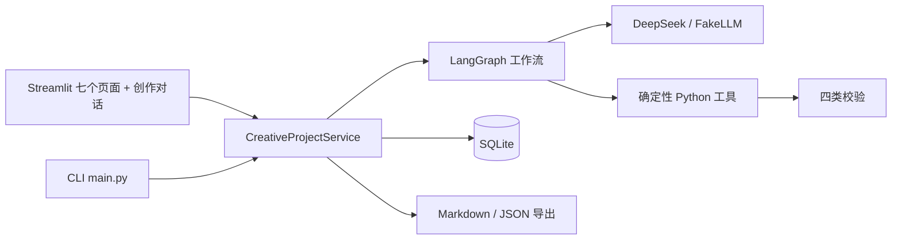
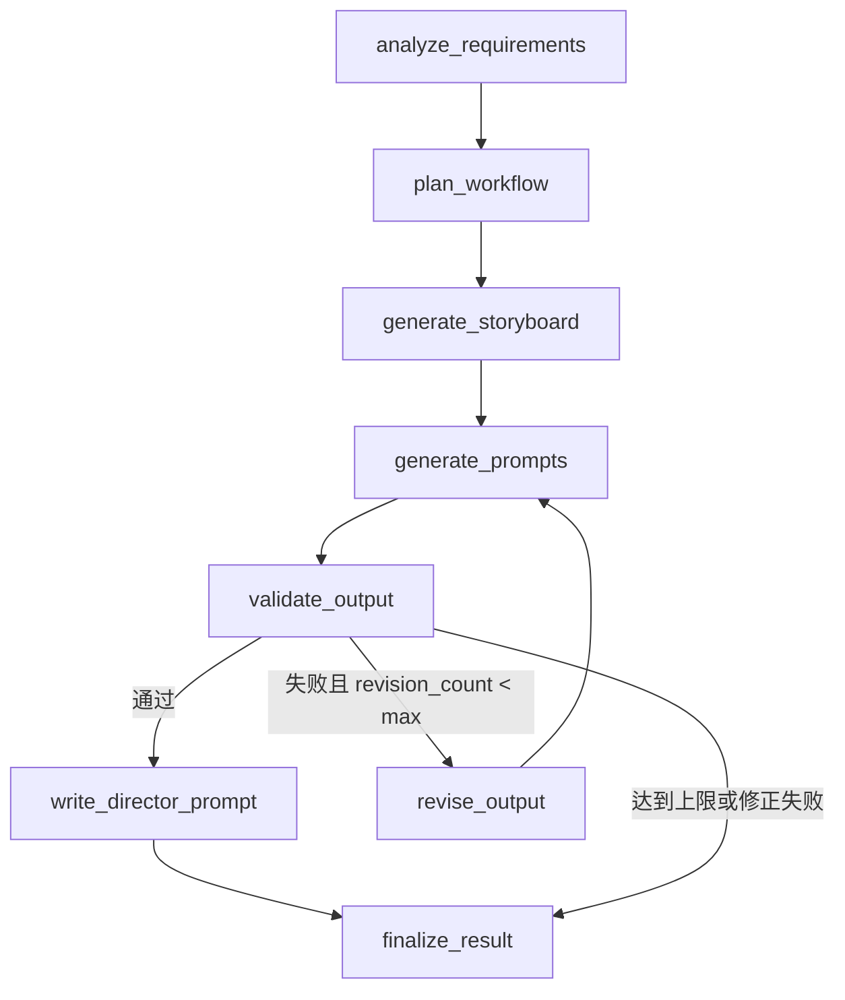

# AIGC 智能创作工作流 Agent 项目报告

> 课程：综合应用开发项目训练  
> 项目：AIGC 智能创作工作流 Agent  
> 技术栈：Python 3.13、LangGraph、DeepSeek、Pydantic、SQLite、Streamlit  
> 代码仓库：<https://gitee.com/qinboqun/aigc-agent>

## 摘要

本项目实现了一个面向 AI 图片、AI 视频和商业广告创作的有状态 Agent 工作流。系统不是把用户输入直接转发给聊天模型，而是先把自然语言需求转换为结构化创作需求，再制定任务计划、生成分镜、用 Python 拼装基础提示词，最后执行时长、场景覆盖、主体一致性和提示词质量四类确定性校验。校验通过后，导演提示词节点再让 DeepSeek 写整片导演提示词、连续性圣经和逐镜头提示词；校验失败时，工作流根据具体错误自动修正，最多两轮；如果仍然失败，系统明确停止并保留失败原因，不把未通过的结果标记为成功。

项目完成了主动引导式创作对话、真实 DeepSeek 调用、LangGraph 状态图、确定性工具、导演级提示词生成、SQLite 持久化、执行轨迹、自动修正循环、提示词优先的 Streamlit 工作台、Markdown/JSON 导出，以及 20 条可复现评测用例。当前默认测试为 127 项通过、1 项真实 API 测试按需跳过；单独执行真实 API 冒烟测试为 1 项通过。20 条评测用例的实际行为全部符合预期。

需要明确的是：系统生成的是**结构化分镜和提示词**，不直接生成图片或视频；确定性检查只能核对时间线、字段、声明和明显矛盾，不能替代最终视觉质量的人工验收。

## 1. 项目背景与目标

### 1.1 背景

AIGC 创作工具通常面临三个问题：

1. **需求不结构化**：用户只给一句自然语言，模型容易自行补全关键信息，导致结果不可控。
2. **生成不可验证**：模型输出的分镜可能时长不对、漏场景、主体前后不一致，但没有可复现的检查机制。
3. **过程不可追溯**：只看到最终文本，看不到调用了什么工具、哪一步失败、是否真的修正过。

本项目把创作过程拆成可观察、可验证、可持久化的 Agent 工作流，重点不是“生成一段看起来不错的分镜”，而是让生成、校验、修正和失败处理都有真实执行依据。

### 1.2 目标

- 解析自然语言或结构化创作需求，并用 Pydantic 固定数据契约。
- 由 LangGraph 驱动有状态工作流，记录每个节点和工具调用。
- 生成专业摄影参数（景别、机位、运镜、灯光、色彩、转场、特效、屏幕方向）。
- 用确定性 Python 工具执行四类校验，不依赖模型自评。
- 校验失败时按具体错误修正，最多两次，禁止无限循环。
- 将项目、任务、分镜、校验报告、修正历史和轨迹写入 SQLite。
- 提供可实际运行的 Streamlit 工作台，而不是只适合截图的原型。
- 用自动化测试和 20 条评测用例证明系统行为，而不是只做口头演示。

### 1.3 范围边界

**已实现：**

- DeepSeek 需求解析、分镜生成和分镜修正。
- DeepSeek 导演级提示词生成，以及演示模式下的确定性提示词兜底。
- 四类校验和最多两次修正循环。
- SQLite 持久化、项目历史、执行轨迹。
- 主动引导 + 提示词优先的 Streamlit 七个页面、Markdown/JSON 导出。
- 20 条评测用例、项目报告和答辩材料。

**未实现：**

- 图片或视频的实际生成接口调用。
- 英文偏好模型（Veo、Runway 等）的提示词方言转换。
- 用户登录、多租户、远程部署。
- 对最终画面进行语义或审美评分。

## 2. 需求分析

### 2.1 功能需求

| 编号 | 需求 | 实现方式 |
|---|---|---|
| F1 | 输入创作需求 | 一句话自然语言 + 动态引导 + 折叠专业快速通道 + CLI，Pydantic 校验 |
| F2 | 解析自然语言需求 | DeepSeek JSON 模式 + 两层 Pydantic 校验 |
| F3 | 制定任务计划 | `plan_workflow` 生成 7 个结构化任务 |
| F4 | 生成分镜 | DeepSeek 或确定性占位分镜 |
| F5 | 生成提示词 | DeepSeek 写整片导演提示词和逐镜头提示词；Python 拼装作为兜底 |
| F6 | 四类校验 | 时长、场景、一致性、提示词质量 |
| F7 | 自动修正 | DeepSeek 修正，确定性时长修复兜底，最多 2 次 |
| F8 | 记录执行轨迹 | 节点、工具、参数、输入输出摘要、错误、时间 |
| F9 | 持久化项目 | SQLite 七张表（含创作会话与资产） |
| F10 | 可视化工作台 | 七个 Streamlit 页面，主动引导对话为入口，提示词包为主结果页 |
| F11 | 导出 | UTF-8 Markdown + 合法 JSON，唯一文件名 |
| F12 | 项目历史 | 搜索、状态筛选、排序、重新载入 |

### 2.2 非功能需求

- **可复现**：确定性工具和脚本化评测不依赖网络。
- **安全**：API Key 只从环境变量读取，不写入源码或日志。
- **诚实**：未执行的检查显示“未执行”，失败不被包装成成功。
- **可维护**：UI、服务、工作流、工具、数据库分层。
- **可测试**：核心路径有单元测试、集成测试和 Streamlit AppTest。

### 2.3 关键约束

- 不引入 Docker、Redis、向量数据库或多 Agent 协作等非必要复杂度。
- 不为了界面效果伪造进度、日志或校验结果。
- 任何数据库调整必须保证已有数据可读。
- 不擅自修改或清空用户已有项目数据。
- API 密钥不进入 Git、日志、执行轨迹或评测报告。

## 3. 系统设计

### 3.1 总体架构



分层：

| 层 | 目录 | 职责 |
|---|---|---|
| 交互层 | `app.py`、`ui/` | 页面、会话状态、后台执行、导出 |
| 应用服务 | `services/` | 主动引导与方案构建、运行工作流、持久化结果、LLM 封装 |
| Agent 层 | `agent/` | 状态、节点、条件路由、LangGraph 图 |
| 工具层 | `tools/` | 分镜、提示词、校验、修正、导出 |
| 数据层 | `database/` | SQLite 建表、读写、查询 |
| 契约层 | `schemas/` | Pydantic 数据模型和枚举 |
| 配置层 | `config/` | 环境变量、摄影词表、模型档案 |
| 评测层 | `evaluation/` | 20 条用例、指标、报告生成 |

### 3.2 工作流



关键设计：

- 需求解析或分镜生成失败时，路由直接进入 `finalize_result`，不再调用下游工具。
- 校验失败不是异常，而是正常分支；由 `route_after_validation` 判断是否修正。
- 修正后必须重新生成提示词并重新校验，不能只改分镜文本就宣称通过。
- 校验通过后，`write_director_prompt` 让 DeepSeek 写整片导演提示词和逐镜头提示词；演示模式跳过该节点，保留规则拼装兜底。
- 导演提示词生成失败时，最终状态为 `failed`，不会用兜底提示词伪装成功。
- 达到 `max_revisions` 后停止，最终状态为 `validation_failed`。
- 修正工具自身失败时，最终状态为 `failed`，保留原始校验报告。

### 3.3 数据契约

核心 Pydantic 模型：

- `CreativeRequirement`：项目名称、内容类型、主体、时长、画幅、场景、镜头语言、一致性约束等。
- `RequirementDraft`：容忍模型输出字符串时长、字符串列表和缺失字段。
- `Shot`：时间、场景、叙事职责、起止动作、主体状态、连续性锁、摄影参数、提示词、声音。
- `Storyboard`：分镜集合、生成方式和提示词生成方式。
- `ShotDraft` / `StoryboardDraft`：容忍模型输出的格式差异。
- `AggregateValidationReport`：聚合四类校验结果。

所有模型默认 `extra="forbid"` 或显式容错，避免模型输出悄悄混入未定义字段。

### 3.4 数据库

SQLite 表：

| 表 | 内容 |
|---|---|
| `projects` | 项目、原始需求、结构化需求、任务计划、分镜 |
| `executions` | 每次执行的状态、开始/结束时间、错误 |
| `execution_traces` | 节点、工具、参数、输入/输出摘要、状态、错误 |
| `validation_reports` | 聚合校验报告 JSON |
| `revision_history` | 修正编号、状态、原因、前后摘要、工具、token 用量 |
| `creative_sessions` | 创作对话、消息、字段来源、待回答问题、方案、项目 ID |
| `creative_assets` | 可复用车辆资产、描述、属性和约束 |

数据库文件位于 `data/aigc_agent.sqlite3`，已被 `.gitignore` 忽略。新增表只做增量建表，不删除或重建已有表；已有项目数据保持可读。

## 4. 关键实现

### 4.1 需求解析

`services/llm_service.py` 使用 OpenAI 兼容 SDK 调用 `deepseek-chat`：

- JSON 模式输出。
- `RequirementDraft` 先容忍解析，`CreativeRequirement` 再做严格校验。
- 超时、429、连接错误和 5xx 有限重试；非法 JSON 和字段错误直接失败。
- 记录调用次数、重试次数、错误次数和 token 用量。
- 错误信息中的 `sk-...` 脱敏。

无法确定的信息不会被模型静默编造：关键字段缺失时失败；非关键字段使用默认值并写入 `pending_confirmations`。

### 4.2 分镜生成

`tools/storyboard_tool.py` 提供两条路径：

- **LLM 路径**：DeepSeek 输出结构化镜头，枚举字段必须使用规定英文值。
- **确定性路径**：没有模型时，按场景数量等分目标时长，生成明确标注的占位分镜。

两条路径都经过 `draft_to_storyboard()` 或 `Storyboard` 校验。模型返回非法枚举、缺少时间或缺少场景时，系统明确报错。

**枚举同义词归一化。** 第一版把模型返回的每个取值严格比对枚举，结果一个 `medium_wide_shot` 就让整次分镜生成失败——这是术语表不全，不是模型错。现在：

- 补齐三个标准景别：`full_shot`（全景）、`medium_wide_shot`（中远景）、`cowboy_shot`（牛仔镜头）；机位补 `ground_level`，运镜补 `crane_orbit`、`dolly_zoom`、`pedestal_up/down`、`whip_tilt`，灯光补 `high_key` / `low_key`，转场补 `fade_to_black`；
- 六个枚举都实现 `_missing_`，接受常见拼写、缩写与中文写法：`Medium Wide Shot`、`MWS`、`中远景`、`全景`、`特写`、`MCU`、`close-up`、`dolly in`、`低调`、`手持`、`慢动作`、`青橙调`、`硬切` 等；
- 归一化不了的取值仍然失败，不做「改成最近的合法值」这种猜测；
- 归一化发生在 `schemas/cinematography.py`，因此需求解析、分镜生成、修正三条路径同时受益。

**用真实用量补词表。** 每次归一化都会记一条 `原始写法 → 规范值`，未知取值单独记录，分镜节点把两者写进执行轨迹（`vocabulary_normalised` / `vocabulary_unknown`）。这样「模型到底在用什么词」是可查的数据，而不是靠我猜下一版该补什么。

**一次纠正重试。** 结构非法（无效 JSON、校验失败）时，把校验错误附回提示词重试一次；第二次仍失败才判定失败。只重试结构错误，不对网络错误或额度错误重试，也不改变「不伪造成功」的原则。

### 4.3 提示词生成

提示词分两层，真实模式以导演提示词为主，规则拼装只做兜底。

#### 4.3.1 导演级提示词（真实模式）

`tools/prompt_writer.py` 在分镜通过四类校验后调用 DeepSeek，输出：

- `global_prompt`：整片导演提示词，包含片名与规格、核心创意、唯一资产锁定、方向与物理规则、逐段分镜、转场、摄影与速度系统、光线、声音、负面约束和结尾英雄镜头。
- `continuity_bible`：全片必须保持的事实清单。
- `shot_prompts`：每个镜头的图片提示词、视频提示词和负向提示词，由模型重写，不是字段标签拼接。
- `negative_prompt` 与 `model_notes`：全片负面约束和目标模型提醒。

导演提示词必须有足够长度和完整结构；过短或缺少镜头提示词时，归一化逻辑会报错。导演提示词生成失败时，项目最终状态为 `failed`，不使用兜底结果伪装成功。

#### 4.3.2 体裁层：八种写法，不是一套模板

第一版只有「汽车 / 非汽车」二分：电商、科幻、动作、动漫拿到的是同一套写作指令，只换了资产描述。这解释了一个现象——提示词格式没错，但换个体裁就不像专业提案。

现在 `config/prompt_dialects.py` 为八个体裁定写作标准：电商视觉、品牌广告、科幻影视、人文剧情、动作追逐、动画动漫、创意实验、纪实。每个体裁定义六件事：

| 维度 | 作用 | 例子（电商 vs 动漫） |
|---|---|---|
| `role` | 写作者身份 | 电商视觉总监 vs 动画监督 |
| `sections` | 整片提示词必须写出的章节 | 商品占画比 / 文字安全区 vs 画风 / 线条 / 作画重心 |
| `shot_rules` | 每条逐镜头提示词必须交代的信息 | 光位、光比、色温 vs 线条粗细、上色方式 |
| `forbidden` | 这个体裁禁止的写法 | 遮挡商品、戏剧化强光 vs 实拍颗粒、3D 渲染感 |
| `negatives` | 默认负面词 | 色差、商品裁切 vs 线条抖动、实拍景深 |
| `length_hint` | 合理篇幅 | 800–1500 字 vs 1500–3000 字 |

体裁由需求解析模型选择（`prompt_dialect` 字段），缺失时按内容类型推断。生成后 `audit_package` 用每个体裁自带的可判定规则检查成稿，把「这个体裁必须出现但文本里没有」的项显示在提示词页。

同一套流程、同一份分镜，三个体裁的实际产出：

| 体裁 | 整片提示词 | 关键差异 |
|---|---:|---|
| 电商视觉 | 551 字 | 商品占画面 60%、右侧 30% 文字安全区、光比 1:2、色温 5600K、负面含「商品裁切 / 色差 / 标签倾斜」 |
| 科幻影视 | 2115 字 | 世界观与技术设定、工程师与舱体 1/50→1/30 的尺度参照、太阳光 + 地球反照的光源来源、负面含「时代错置道具 / 魔法光」 |
| 动画动漫 | 711 字 | 九十年代赛璐璐、线条粗细与平涂硬阴影、作画重心、手绘水彩背景、负面含「实拍景深 / 3D 渲染感」 |

#### 4.3.3 图片与视频是两种写作任务

把两种提示词当成「同一段的两个长度」是错的：图片要冻结一帧，视频要说明这一帧怎么变过去。项目里两者现在分开定义、分开生成、分开审计。

| | 图片提示词 `image_prompt` | 视频提示词 `video_prompt` |
|---|---|---|
| 写什么 | 最有信息量的那一帧：景别、焦段、构图、光位、材质、画幅 | 时长、起止状态、摄影机运动、主体运动、环境运动、切点 |
| 禁止 | 时间推进、镜头运动过程、转场、音频 | 只写一帧的静态描述 |
| 体裁侧重 | 电商：商品占比与文字安全区 | 电商：展示动作与镜头位移如何证明尺寸与材质 |
| 审计 | `image_audit`：景别/焦段、光、材质、画幅 | `video_audit`：时长、运动、起止变化 |

通用规则在 `IMAGE_RULES` / `VIDEO_RULES`，体裁只追加自己的侧重。提示词页拆成「图片生成」「视频生成」两个板块，各自整包复制/下载与逐条查看。

同一次真实调用（电商体裁）里，两段的差异是结构性的：图片写「平视机位，35mm 等效，全景景别，商品占画面 60%，右侧 68%–96% 为文字安全区，光比 1:2.5」；视频写「时长 8 秒，起始状态→结束状态，极缓慢匀速推镜，幅度 8%–10%，环境运动与切点」。两者没有重复的句子。

#### 4.3.4 规则拼装兜底（演示模式）

`tools/prompt_builder.py` 不调用模型，而是从结构化字段拼装：

- 主体状态、场景、动作链、摄影参数、光线与色彩、风格、一致性约束。
- 图片提示词和视频提示词分别生成。
- 根据目标模型档案处理负向提示词差异。例如 Runway 不支持负向提示词时，改用正向描述。
- 同一输入得到相同提示词，便于测试和复盘。

演示模式或导演提示词不可用时，提示词页面会明确标注“兜底提示词”，不会把它当成导演级结果。

#### 4.3.5 字段随品类变化

字段体系最初是汽车优先的：`vehicle_type / vehicle_design / vehicle_description / vehicle_reference` 写进了通用字段表。后果很直接——校园短片里，模型会看到「当前还缺的字段：车型、外观方向」，于是它开始替这套字段找归宿，问出「车里到底在不在场」。

现在字段按品类裁剪：

- `allowed_fields(automotive)` 返回该项目允许的字段集合；非汽车项目里根本没有 `vehicle_*`；
- 系统提示按品类生成：非汽车版本中不出现车型、外观方向、车头、车灯、轮胎、道路中的任何一个词（有测试断言）；
- 用户提示里「当前还缺的字段」只列允许字段，不会再出现「车型 待确定」；
- 引擎在写回 `understood` 时再过滤一次，模型即使写了 `vehicle_type` 也会被丢弃；
- 决策面板同样隐藏这些行；
- 原来的 `CRITICAL_FIELDS`（含车辆字段）已删除，改为通用的 `REQUIRED_FIELD_KEYS`。

判定的优先级是内容类型高于关键词：校园、剧情、短片、美妆、动画等类型一律视为非汽车项目，即使原句里提到车。

### 4.4 四类确定性校验

| 检查 | 工具 | 主要规则 |
|---|---|---|
| 时长 | `duration_checker.py` | 数字有效、负时长、重叠、空档、首帧前导空档、总时长容差 |
| 场景覆盖 | `scene_checker.py` | 缺失必需场景、重复场景警告、覆盖率 |
| 主体一致性 | `consistency_checker.py` | 连续性锁、主体原样描述、车辆方向、屏幕方向、文本方向矛盾 |
| 提示词质量 | `prompt_checker.py` | 必要字段、矛盾约束、单镜头多运镜、模型负向提示词/语言差异 |

这些检查不询问模型“你觉得好不好”，而是用可复现的规则判断。关键词规则可能误报或漏报，因此一致性报告包含 `semantic_notes`，明确说明文本检查不能证明最终画面一致。

### 4.5 修正循环

`revise_output` 有两种实现：

- **有模型**：把需求、当前分镜、方向审计和具体校验错误交给 DeepSeek，要求只修列出的问题。
- **无模型**：只有“时长是唯一失败项”时才允许确定性缩放时间线；其他问题需要模型。

修正次数写入状态和数据库。达到上限后：

- 最终状态 `validation_failed`；
- 保留最后一次校验报告；
- 错误信息包含“已达到自动修正上限 2 次”；
- 不继续循环，不伪造完成。

### 4.6 执行轨迹与可追溯性

每个节点和工具调用记录：

- 节点名、工具名、工具参数；
- 输入摘要、输出摘要；
- 状态、错误、时间。

轨迹来自真实函数调用和 LangGraph 流式状态，不是前端预设动画。Streamlit 执行页面通过后台线程和队列读取真实事件。

### 4.7 主动引导式创作 Agent

阶段 3 把“用户先填内部表单”改成了“用户表达创意，Agent 负责拆解”。它不是固定问卷，也不是规则问卷：每一轮由 DeepSeek 读取“已确认决策 + 当前问题 + 最近对话”，自己判断这一步该继续追问、给方案、改方案还是开始生成（`services/agent_director.py`）。问哪一项、为什么现在问、给哪些选项、推荐哪个，都由模型现场决定；选项按当前创意生成，带描述、适用场景、代价和推荐标记，而不是从写死的列表里查表。模型同时返回自己的推理依据，界面以「Agent 思考过程」原样展示，用户和答辩评审可以逐条核对。

模型返回的结构由 Pydantic 强校验，但契约对同义键（`text`/`prompt`、`tone`/`visual_style` 等）容错：无法归属到合法字段的内容直接丢弃，无法归位的提问先要求模型重问一次，仍不行就抛 `AgentContractError`。

**对话层没有规则兜底。** 早期版本在模型不可用时会退回一套写死的选项表，结果是护肤品广告被问“选哪些场景”，选项是校园 / 教室 / 宿舍 / 天台——看起来能用，实际上在骗人。现在这条路被删掉了：未配置密钥时工作台直接显示「决策层不可用」；模型超时、网络错误、非法 JSON 时本轮失败并显示原因；关键决策缺失时强制追问一次，补不齐就失败。留给用户的仍然是可用路径：项目历史、提示词、分镜、校验报告、导出，以及显式标注的「专业快速通道」（直接填写结构化简报进入确定性工作流，不经过对话层）。

### 4.7.1 选项必须是可执行的制作方案

第一版选项的问题是“像文案不像提案”：只有「高级质感」「一束光的雕塑」这类形容词，没有焦段、光位、运镜设备和代价。现在每个选项是一个结构化契约：

| 字段 | 要求 | 示例 |
|---|---|---|
| `label` | 技术 + 画面，8–16 字 | 单灯硬光·静止雕塑 |
| `technique` | 焦段 / 光位与光质 / 摄影机运动 / 画质参数，至少两项 | 100mm 微距 · 单灯裸光 45° 侧逆 · 固定机位 · f/8 全清晰 |
| `description` | 这套参数拍出来观众看到什么 | 瓶身只被一道硬光切出轮廓，其余全黑，8 秒不动机位 |
| `best_for` | 什么品类与传播目标下选它 | 高端护肤、香水等需要建立「贵」与「精确」的产品向广告 |
| `tradeoff` | 制作代价：置景、周期、后期量、预算 | 要彻底除尘，指纹和浮尘会被放大，单镜头置景 4 小时以上 |
| `reference` | 可对照的坐标，没有就写「无」 | Aesop 产品静物；Mert & Marcus 的硬光质感 |

系统提示里给出「不合格 vs 合格」的对照样例，并明确禁止只写情绪词、禁止编造不存在的片名。界面把 `technique` 渲染成等宽参数条、`reference` 单独一行，用户一眼能看出这是制作方案而不是广告词。

三条不变式由回归测试固定：

1. **点选与打字走同一条决策路径。** 用户点一个选项，同样交给模型判断下一步。早期实现里 `choose()` 直接落到规则表，导致点一下之后 Agent 掉线：护肤品广告被问“选哪些场景”，选项还是校园 / 教室 / 宿舍 / 天台。
2. **品类词表不跨行业。** 汽车词表只在汽车项目里运行：护肤品描述里的“极简、流线型”不会被写成“外观方向”；没有模型时也不再有“分行业的死表”可以顶上来。
3. **选项必须带制作参数。** 没有 `technique` 的选项就是一句广告词，不能作为专业提案展示；这一条由契约字段和提示词里的对照样例共同保证。

对产品向创意（美妆、食品、数码、时尚），系统不会问“你想选哪些场景”——这类片子的空间是光和材质，由 Agent 直接决定，把提问留给呈现方式、质地、光位、使用仪式、成分或工艺。这一点写进了导演决策层的系统提示。

三种推进模式：

| 模式 | 触发 | 行为 |
|---|---|---|
| 主动引导 | 创意模糊，关键信息不足 | 模型选择当前最影响结果的一项追问，现场生成专业选项、通俗解释和推荐理由 |
| 专业自主 | “你决定”“全部帮我设计” | 模型直接补齐它认为最专业的取值，方案中标记“Agent 根据上下文推断” |
| 详细快速通道 | 用户已给出车型、时长、场景、运镜等 | 不重复询问已知信息，只补问真正缺失项 |

模型判断“够了”但关键字段仍缺失时，系统会再发起一次强制追问，而不是掉回写死的选项表；这条“观察 → 判断 → 再行动”的回路是它与单向问卷的主要区别。

创作状态包括：

- 字段值、来源（用户明确 / 用户选择 / Agent 推断 / 创作资产 / 系统默认 / 未确定）、是否确认；
- 当前阶段、待回答问题、方案、对话消息、轮次；
- 项目 ID、参考文件名、执行状态；
- 可复用车辆资产。

修改支持：

- “把沙漠改成海岸公路，其他都不要变”；
- “缩短到 15 秒”；
- “不要夜景，全部改成白天”；
- “第三个镜头改成贴地追拍”（当前按整片新版本重新生成，并保留其他决策）；
- 修改后复用同一 `project_id` 新增 execution，不丢失之前版本。

持久化新增两张表：`creative_sessions` 和 `creative_assets`。数据库只做增量建表，不删除已有项目。


### 4.8 Streamlit 工作台

七个页面，以主动引导对话为入口、提示词包为主结果页：

1. **创作工作台**：一句话输入、主动追问、动态选项、专业推荐、方案确认、增量修改、最近对话恢复；专业快速通道折叠保留。
2. **提示词包**：整片可复制提示词包、逐镜头图片/视频/负向提示词、TXT 下载、模型适配提示。
3. **分镜详情**：分镜表、镜头详情、摄影参数、连续性约束。
4. **校验报告**：四类状态、通过/警告/失败/未执行、修正历史。
5. **执行过程**：真实流式事件、任务计划、工具轨迹、修正记录。
6. **项目历史**：SQLite 读取、搜索、筛选、排序、重新载入、恢复创作对话。
7. **导出**：Markdown/JSON 生成、唯一文件名、下载和预览。

配置了 `DEEPSEEK_API_KEY` 时，工作台自动使用真实模型；未配置时进入明确标注的演示模式。页面不再暴露模型开关，后台任务不会因页面重运行而重复启动。

创作工作台：


提示词包（真实 DeepSeek 生成结果）：


### 4.9 安全与数据保护

- API Key 只从 `.env` 或环境变量读取。
- `.env` 和 `.history/` 已被 `.gitignore` 忽略。
- `.env.example` 只包含空模板。
- 日志、轨迹和评测报告不包含密钥；评测报告会扫描 `sk-` 样式字符串。
- 不删除或清空已有项目数据；数据库只做增量建表。
- 导出使用明确目标路径和唯一文件名，不覆盖已有文件。

## 5. 测试与评测

### 5.1 自动化测试

```text
127 passed, 1 skipped
```

默认跳过的 1 项是真实 API 测试。单独执行：

```text
1 passed in 3.21s
```

测试覆盖：

- 需求、分镜、提示词、校验、修正、数据库、导出；
- FakeLLM 成功、非法 JSON、超时重试、重试耗尽；
- 时长、场景、一致性、提示词检查器；
- Streamlit 七个页面、一句话开始创作、动态问题、引导流程、增量修改、同一项目二次执行、提示词包、历史、导出；
- 后台执行、状态转换、空数据和错误状态。

### 5.2 20 条评测用例

评测入口：

```powershell
.\.venv\Scripts\python.exe -m evaluation --output-dir output/evaluation
```

用例构成：

| 类型 | 数量 | 内容 |
|---|---:|---|
| 确定性工作流 | 8 | 不同时长、场景数、默认值、非车辆主体、Runway 警告 |
| 脚本化 LLM 工作流 | 9 | 首次通过、时长/场景/方向/动作修正、上限、非法 JSON |
| 工具级 | 3 | 空档/重叠、缺失/重复场景、提示词冲突 |

实际结果：

| 指标 | 结果 |
|---|---:|
| 期望匹配 | 20 / 20 |
| completed | 13 |
| validation_failed | 1 |
| failed | 3 |
| 工具级 | 3 |
| 首次通过 | 9 / 17 |
| 修正后通过 | 4 |
| 修正恢复率（有效修正响应） | 4 / 5 |
| SQLite 状态一致 | 17 / 17 |
| 脚本化模型调用 | 29 次 |
| 脚本化合成 tokens | 870 |
| 导出验证 | 通过 |
| 密钥样式扫描 | 通过 |

注意：20/20 表示**实际行为符合用例预期**，不等于 20 条创作结果都通过校验。4 条用例被设计为预期失败：

- `llm-06`：两次修正后仍缺场景，达到上限；
- `llm-07`：分镜响应非法 JSON；
- `llm-08`：需求响应非法 JSON；
- `llm-09`：修正响应非法 JSON。

系统在这些情况下都明确停止，没有伪造成功。另有 3 条工具级用例用于证明检查器能准确报出空档、重叠、缺失场景、重复场景和提示词冲突。

完整逐用例结果、失败分析和指标见 [evaluation_report.md](evaluation_report.md)。

### 5.3 真实 API 验证

开发阶段已完成真实 DeepSeek 调用验证，包括：

- 最小 JSON 冒烟测试；
- 需求解析；
- 分镜生成 + 四类校验；
- 导演提示词生成（整片 + 逐镜头）；
- 两次修正仍失败的完整循环；
- 单次分镜修正从 27 秒修复到 30 秒。

当前阶段重新执行了真实 API 冒烟测试：

```text
1 passed in 3.21s
```

并通过真实 API 集成运行验证了从对话构建需求到执行的完整路径：DeepSeek 完成需求解析、分镜生成、1 次修正和导演提示词生成，共 4 次模型调用、累计 29390 tokens，生成 6 个镜头，四类校验通过；导演提示词 2998 字符。

另用真实 API 跑了一次 15 秒校园剧情短片，验证非车辆分支：3 次模型调用、13953 tokens、5 个镜头、0 次修正、completed；导演提示词 2042 字符，其中“车头/车尾/轮胎/道路连续性/车辆动作/不适用”均为 0 处。导演提示词模板会按项目类型分支，并在保存前清洗模型误带的车辆专属段落；非车辆项目不会再输出“本片无车辆，但车头/前进方向……”这类占位内容。

默认评测和默认测试不调用真实 API，避免消耗额度。真实模型的分镜质量和审美仍需人工评审。

答辩幻灯片使用 Edge headless 渲染关键页面进行检查，并成功打印为 12 页 PDF；这不等同于多浏览器视觉回归。

工作台通过 Edge + CDP 在真实浏览器中完成了引导对话和方案预览的验证；真实 API 集成运行确认了执行闭环和“修正后重新校验”，而不是直接宣布成功。

## 6. 项目特色

1. **不是聊天壳**：有状态图、真实工具、条件分支、持久化和轨迹。
2. **确定性校验**：时长、场景、一致性、提示词质量由 Python 规则检查。
3. **有限修正**：最多两次，失败就停止，有明确上限。
4. **诚实状态**：未执行、警告、失败和成功分开显示。
5. **可追溯**：每次工具调用和修正都有数据库记录。
6. **可复现评测**：20 条用例、脚本化模型、自动生成报告。
7. **导演提示词层**：DeepSeek 重写整片提示词和逐镜头提示词，Python 拼装只做兜底。
8. **产品级 UI**：统一设计系统、真实后台执行、历史与导出。
9. **安全边界**：密钥不落库、不进入日志、不进入 Git。

## 7. 局限性与改进方向

### 7.1 当前局限

- 不生成图片或视频，只生成结构化分镜和提示词。
- 导演提示词质量取决于 DeepSeek 输出和分镜信息；单次生成约 1800-2000 字符，仍可能不如人工多轮打磨的万字级提示词。
- 确定性检查是文本/结构检查，不能保证最终画面一致。
- 英文偏好模型的提示词方言转换尚未实现。
- 评测默认使用脚本化 FakeLLM，不能替代真实模型质量评测。
- 没有用户登录、多租户和远程部署。
- Streamlit 后台线程依赖进程存活，进程被强制终止时可能留下 `running` 记录。
- 历史列表最多显示 100 条，UI 暂无分页。
- 未做真实浏览器截图或视觉回归。

### 7.2 后续方向

1. 增加英文提示词方言转换和模型适配层。
2. 增加真实 API 的分层评测（需求解析、分镜、修正分开统计）。
3. 增加人工审美评分和失败案例库。
4. 增加任务持久化队列，避免进程终止导致状态悬挂。
5. 增加用户与项目权限。
6. 接入实际图片/视频生成 API，并保留“生成前校验、生成后验收”的边界。

## 8. 总结

本项目完成了一个可运行、可测试、可解释的 AIGC 创作工作流 Agent。它把自然语言需求、结构化分镜、导演提示词、确定性工具、有限修正、数据库和界面连接成完整闭环，并通过 127 项默认测试、1 项真实 API 测试和 20 条评测用例验证了主要行为。

项目的核心价值不是“让模型写出一段分镜”，而是让每一步都可检查、可记录、可复现；当系统无法解决问题时，它会明确失败，而不是把失败包装成成功。

## 附录 A：运行命令

```powershell
cd D:\Projects\aigc_creative_agent

# Streamlit 工作台
.\.venv\Scripts\python.exe -m streamlit run app.py

# 命令行确定性演示
.\.venv\Scripts\python.exe main.py --demo

# 命令行 DeepSeek 模式
.\.venv\Scripts\python.exe main.py --demo --use-llm

# 默认测试
.\.venv\Scripts\python.exe -m pytest -q

# 20 条评测
.\.venv\Scripts\python.exe -m evaluation --output-dir output/evaluation
```

## 附录 B：关键文件

| 文件 | 作用 |
|---|---|
| `agent/graph.py` | LangGraph 节点和边 |
| `agent/nodes.py` | 需求、计划、分镜、提示词、校验、修正、归档节点 |
| `agent/routing.py` | 条件路由 |
| `tools/validation_pipeline.py` | 四类校验聚合 |
| `tools/revision_tool.py` | 确定性/LLM 修正 |
| `tools/prompt_writer.py` | DeepSeek 导演提示词、连续性圣经、逐镜头提示词 |
| `tools/prompt_package.py` | 整片提示词包与下载文件名 |
| `services/project_service.py` | 执行、流式输出、持久化 |
| `services/llm_service.py` | DeepSeek 调用、校验、重试、脱敏 |
| `database/repository.py` | 项目、执行、轨迹、报告、修正记录 |
| `ui/pages/prompts.py` | 提示词包主结果页 |
| `ui/` | Streamlit 设计系统、创作对话、状态、组件、七个页面 |
| `evaluation/` | 20 条用例、执行器、报告生成 |
| `docs/evaluation_report.md` | 自动生成的评测报告 |
| `docs/defense.md` | 答辩提纲、讲稿和问答 |
| `docs/defense_slides.html` | 可浏览器播放/打印的答辩幻灯片 |
| `docs/defense_slides.pdf` | 已生成的 12 页答辩 PDF |

## 附录 C：参考资料

外部资料调研、star 数、许可证和借鉴边界见 [references.md](references.md)。项目只借鉴公开的摄影/分镜术语和工程思路，不复制外部仓库代码或大段文字。
